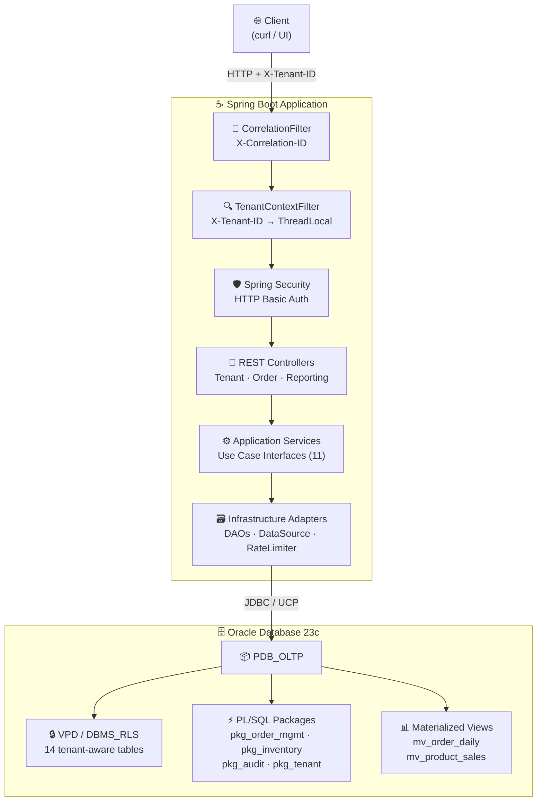
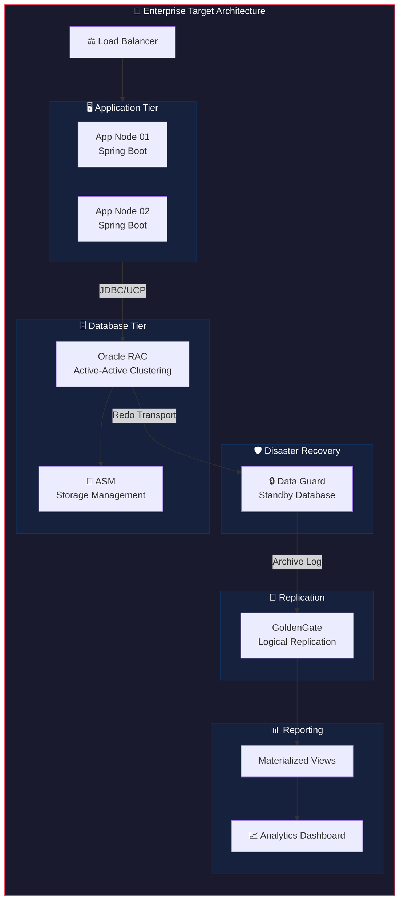
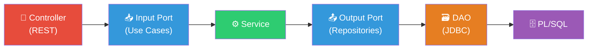
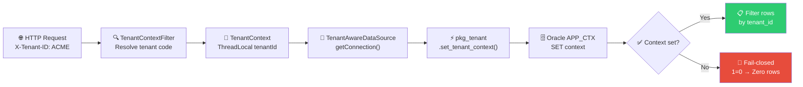
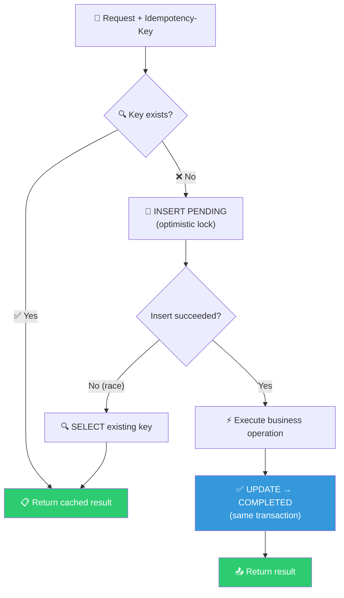
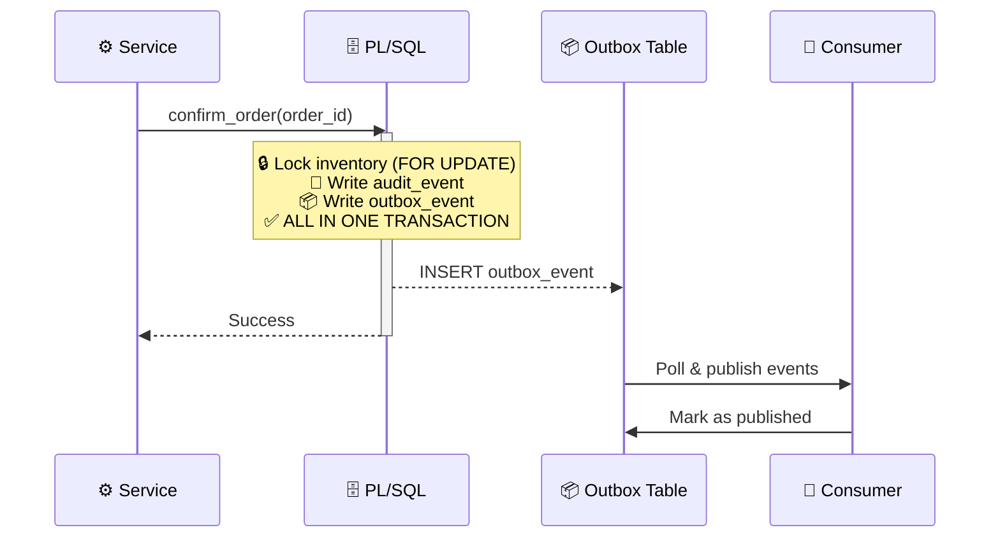
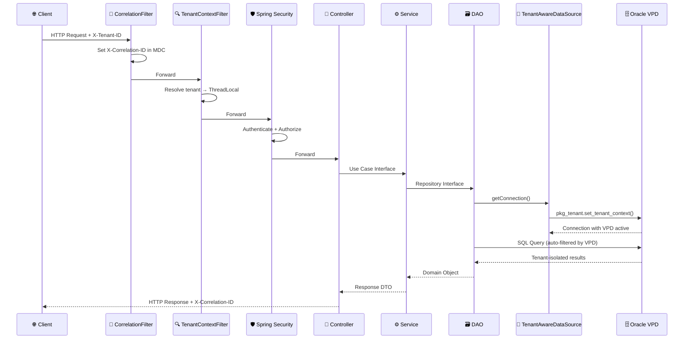
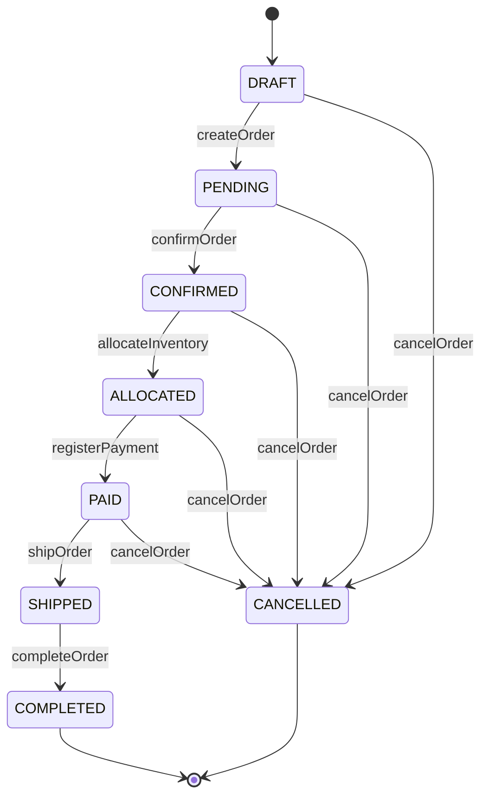

<div align="center">

# 🏢 Enterprise Order Platform

### *Resilient Enterprise Architecture on Oracle 23c: Zero Downtime, Active-Active Clustering & Disaster Recovery*

**🗃️ Multi-Tenancy · 🔷 Hexagonal Architecture · ⚡ PL/SQL · 🔒 VPD · 🔄 Idempotency · 📦 Transactional Outbox**

[](https://openjdk.org/projects/jdk/21/)
[](https://spring.io/projects/spring-boot)
[](https://www.oracle.com/database/)
[](https://flywaydb.org/)
[](LICENSE)
[](https://podman.io/)

</div>

---

A proof-of-concept enterprise multi-tenant order management platform built on Oracle Database, demonstrating hexagonal architecture, database-level tenant isolation (VPD/DBMS_RLS), PL/SQL business logic, idempotent operations, transactional outbox pattern, and materialized view reporting — showcasing Oracle as a full enterprise application platform.

## ⚠️ Disclaimer

> This project is developed for **educational and research purposes** only. It is intended to provide hands-on experience and deepen knowledge in **Oracle Database as an application platform**, **hexagonal architecture**, **multi-tenancy patterns**, and **enterprise integration**. It is **not designed** for deployment in production environments.

The primary focus is to explore **PL/SQL business logic close to data**, **database-level security (VPD)**, **connection pooling (UCP)**, **idempotent operations**, and **transactional outbox patterns** — emphasizing developer learning and architectural exploration in a controlled environment.

---

## 🏗️ High-Level Architecture



---

## 🏢 Enterprise Target Architecture



---

## 🗃️ Why Oracle Database?

Oracle Database was chosen as the core platform for this POC for deliberate reasons that align with enterprise-grade application requirements:

### 🖥️ Database as Application Platform

Unlike traditional CRUD-over-HTTP architectures, this POC pushes business logic **into the database** via PL/SQL packages. The `confirm_order` procedure atomically validates, locks inventory (`SELECT FOR UPDATE`), reserves stock, transitions status, writes audit events, and writes outbox events — all in a single database transaction. This eliminates distributed transaction complexity and ensures ACID guarantees across all business operations.

### 🔐 Multi-Tenancy at the Database Layer

Oracle VPD (Virtual Private Database) / DBMS_RLS provides **invisible, fail-closed tenant isolation** at the database level. Every SQL statement is automatically filtered by tenant — no application code can accidentally leak data across tenants. The predicate `SYS_CONTEXT('APP_CTX','TENANT_ID') = tenant_id` is enforced on all 14 tenant-aware tables, including materialized views.

### 🔗 Connection Pooling Without ORM

Oracle UCP (Universal Connection Pool) with explicit JDBC eliminates the overhead and opacity of JPA/Hibernate. Every SQL call is visible, every PL/SQL invocation is explicit, and the connection lifecycle (including VPD context setup and cleanup) is fully controlled by the application.

### ⚡ Concurrency Control

Pessimistic locking via `SELECT FOR UPDATE` in PL/SQL prevents overselling inventory under concurrent load. The concurrency test demonstrates that with exactly 1 unit of stock and N parallel workers, exactly 1 worker confirms successfully while all others fail with `INSUFFICIENT_INVENTORY`.

---

## 💪 Strengths and Weaknesses

### ✅ Strengths

| Aspect | Detail |
|---|---|
| 🔐 **Database-level multi-tenancy** | VPD/DBMS_RLS on 14 tables — invisible, fail-closed isolation. No application code can leak cross-tenant data. |
| ⚡ **Atomic business logic** | PL/SQL `confirm_order` procedure: validates + locks + reserves + transitions + audits + outbox in one transaction. |
| 🔷 **Hexagonal architecture** | Clean port/adapter separation. Controllers depend on use case interfaces, services depend on repository interfaces. Domain has zero infrastructure dependencies. |
| 🔄 **Idempotent operations** | Confirm order and payment registration are idempotent via `idempotency_key` table — safe under retries and network partitions. |
| 📦 **Transactional outbox** | Outbox events written atomically by PL/SQL within the same transaction as business mutations — guaranteed at-least-once delivery. |
| 🛡️ **Pessimistic locking** | `SELECT FOR UPDATE` on inventory prevents overselling. Concurrency test proves exactly-1-of-N success with stock=1. |
| 👤 **Least privilege** | Three Oracle users: `APP_OWNER` (DDL), `APP_RUNTIME` (DML), `APP_REPORTING` (read-only). |
| 📊 **Materialized Views** | OLTP-reporting separation via `MV_ORDER_DAILY_SUMMARY` and `MV_PRODUCT_SALES_SUMMARY` with on-demand refresh. |
| 🔭 **Observability** | Correlation ID propagation, structured JSON logging, Prometheus metrics via Micrometer. |
| 🔗 **Connection pooling** | Oracle UCP with validation-on-borrow, connection timeouts, and automatic tenant context setup/cleanup. |
| ⚙️ **Profile-based config** | Local/test/prod profiles with externalized secrets via environment variables. |

### ⚠️ Weaknesses / Tradeoffs

| Aspect | Detail |
|---|---|
| 📡 **No JPA/Hibernate** | Explicit JDBC requires more boilerplate but provides full SQL control. Tradeoff: developer productivity vs. transparency. |
| 🗄️ **PL/SQL business logic** | Database-centric logic is harder to version control and test locally. Mitigated by Flyway migrations and SQL-based tests. |
| 🖥️ **Single-instance Oracle Free** | No RAC, ASM, or Data Guard locally. Enterprise architecture is documented but not simulated. |
| 🔑 **In-memory credentials** | Spring Security uses `InMemoryUserDetailsManager`. A production setup would use LDAP/OAuth2. |
| 🔗 **No distributed tracing** | Correlation ID is propagated but not integrated with Jaeger/Zipkin. |
| 🔄 **GoldenGate not running** | Extract/Replicat configuration is documented but not deployed locally. |

---

## 🧠 Design Decisions

### 🔷 Hexagonal Architecture (Ports & Adapters)

The backend follows hexagonal architecture with strict dependency direction:



- **📥 Input ports** define what the application can do (11 fine-grained use case interfaces)
- **📤 Output ports** define what the application needs (5 repository interfaces)
- **🗃️ Adapters** implement the ports (REST controllers, JDBC DAOs)
- **💎 Domain** has zero framework dependencies (pure Java records and enums)

This allows swapping the JDBC adapter for an in-memory adapter in tests without modifying the service layer.

### 📡 JDBC Over JPA (SRS §50)

JPA/Hibernate was deliberately excluded. The POC demonstrates:

- 🎯 Explicit SQL control for Oracle-specific features (FOR UPDATE, PL/SQL calls, VPD)
- 📞 Direct `CallableStatement` usage for stored procedure invocation
- 🔍 No hidden SQL generation — every query is visible and auditable
- 🔗 Connection-level tenant context management (`TenantAwareDataSource`)

### 🔒 VPD Over Application-Level Filtering (SRS §13, §52)

Tenant isolation is enforced at the database level, not in application code:



This means even a SQL injection vulnerability cannot leak cross-tenant data.

### 🔄 Idempotency at the Database Level (SRS §62, FR-014)

The `IDEMPOTENCY_KEY` table with unique constraint per tenant prevents duplicate operations:



### 📦 Transactional Outbox Pattern (SRS §63)

Outbox events are written by PL/SQL **within the same transaction** as business mutations:



This guarantees atomic consistency — the outbox event cannot exist without the business mutation, and vice versa.

---

## 🏗️ Architecture — Request Flow



---

## ✨ Features

### 🔐 Multi-Tenancy with VPD (Virtual Private Database)

Tenant isolation is enforced at the database level using Oracle VPD/DBMS_RLS:

- 🗃️ **14 tables** covered by VPD policies (tenant, customer, product, inventory, orders, payments, audit, outbox, etc.)
- 🔒 **Fail-closed predicate**: Without `SYS_CONTEXT('APP_CTX','TENANT_ID')`, queries return zero rows
- 🤖 **Automatic filtering**: Every SQL statement (SELECT, INSERT, UPDATE, DELETE) is filtered by tenant
- 🛡️ **Defense-in-depth**: Even SQL injection cannot leak cross-tenant data

### 📋 Order Lifecycle Management

Complete order workflow with state machine enforcement:



- ✅ State transitions are validated by `OrderStatus.canTransitionTo()`
- ⚡ PL/SQL `confirm_order` atomically: validates → locks inventory → reserves stock → transitions status → writes audit → writes outbox
- 🔄 Idempotent confirm/payment operations prevent duplicate processing

### 🛡️ Inventory Concurrency Control

Pessimistic locking prevents overselling:

- 🔒 `SELECT FOR UPDATE` in `pkg_inventory.reserve_stock` locks the inventory row
- ⏳ Concurrent transactions queue on the lock — only one can reserve
- ✅ `CHECK` constraint ensures `available_quantity >= 0`
- 🧪 Concurrency test: stock=1, N workers → exactly 1 confirms, rest fail with `INSUFFICIENT_INVENTORY`

### 🔄 Idempotent Operations

Critical operations are idempotent via `idempotency_key` table:

- 📨 `confirm_order` and `register_payment` accept `Idempotency-Key` header
- 📝 First execution: insert PENDING → execute → mark COMPLETED (all in one transaction)
- 🔁 Retry: return cached result without re-execution
- 🔒 Unique constraint per tenant prevents race conditions

### 📦 Transactional Outbox Pattern

Reliable event publishing without distributed transactions:

- 📦 Outbox events written by PL/SQL **within the same transaction** as business mutations
- ✅ Guaranteed at-least-once delivery
- 📡 Consumer polls `outbox_event` table and marks events as published
- 🔗 No dual-write problem — outbox and business data are always consistent

### 📊 Materialized View Reporting

OLTP-reporting separation via Oracle Materialized Views:

- 📊 `MV_ORDER_DAILY_SUMMARY`: daily order counts, revenue, average order value
- 📊 `MV_PRODUCT_SALES_SUMMARY`: product sales ranking with period aggregation
- 🔄 Complete refresh on demand via `DBMS_MVIEW.REFRESH`
- ⏱️ Rate-limited refresh (60-second cooldown) to prevent OLTP impact
- 🔒 VPD-protected — reporting is automatically tenant-isolated

### 🔭 Observability

Enterprise-grade observability stack:

- 🔗 **Correlation ID**: `X-Correlation-ID` propagated through filters, MDC, and database calls
- 📝 **Structured logging**: JSON format with timestamp, level, service, thread, correlationId, tenantId
- 📊 **Prometheus metrics**: Micrometer + Actuator for health, metrics, and Prometheus scraping
- 🗄️ **PL/SQL audit trail**: `audit_event` table records all state transitions with actor and correlation ID

---

## ⚙️ Configuration Reference

### 📋 Application Configuration

| Property | Env Var | Default | Description |
|----------|---------|---------|-------------|
| `oracle.url` | `ORACLE_URL` | `jdbc:oracle:thin:@localhost:1521/pdb_oltp` | 🔗 Oracle connection URL |
| `oracle.username` | `ORACLE_USER` | `APP_RUNTIME` | 👤 Database username |
| `oracle.password` | `ORACLE_PASSWORD` | — (required) | 🔑 Database password |
| `oracle.ucp.max-pool-size` | — | `20` | 📊 Maximum connection pool size |
| `app.security.admin.password` | `APP_ADMIN_PASSWORD` | `changeme` | 🔑 Admin user password |
| `app.security.operator.password` | `APP_OPERATOR_PASSWORD` | `changeme` | 🔑 Operator user password |

### 🐳 Container Configuration

| Variable | Default | Description |
|----------|---------|-------------|
| `ORACLE_SID` | `CDB1` | 🗄️ Oracle System Identifier |
| `ORACLE_PDB` | `PDB_OLTP` | 📦 Pluggable Database name |
| `ORACLE_PWD` | — (required) | 🔑 Oracle SYS/SYSTEM password |
| `ORACLE_LISTENER_PORT` | `1521` | 🌐 Oracle listener port |

---

## 🧪 Testing

### 🚀 Run All Checks

```bash
cd backend
mvn clean test
```

### 📋 Test Types

| Type | File | What It Tests |
|------|------|---------------|
| 🧪 Unit | `OrderServiceTest.java` | Order service logic, idempotency, tenant context |
| 🧪 Unit | `PlsqlErrorMapperTest.java` | Oracle error code → API error code mapping |
| 🧪 Unit | `GlobalExceptionHandlerTest.java` | Exception → JSON error response mapping |
| 🔗 Integration | `IT_order_to_payment.sql` | Full lifecycle: create → confirm → pay → MV refresh → assert |
| ⚡ Concurrency | `run_concurrency_test.bat` | N workers compete for 1 stock unit → exactly 1 confirms |
| 🔒 Security | `T_security_tenant_isolation.sql` | VPD: tenant 1 cannot see tenant 2 data |

### 📊 Test Coverage

| Component | Coverage | Tests |
|-----------|----------|-------|
| PlsqlErrorMapper | 100% ✅ | 9 tests (all ORA code mappings) |
| GlobalExceptionHandler | 100% ✅ | 7 tests (all exception types) |
| OrderService | 85%+ ✅ | 8 tests (create, confirm, cancel, idempotency, tenant context) |

### ⚡ Concurrency Test

```bash
# From project root
cd tests/concurrency
run_concurrency_test.bat
```

> Verifies pessimistic locking: with stock=1 and 5 parallel workers, exactly 1 worker confirms.

### 🔒 Security Test

```sql
-- Connect as APP_RUNTIME and run:
@tests/security/T_security_tenant_isolation.sql
```

> Verifies VPD isolation: tenant 1 cannot see tenant 2 data, and no-context returns zero rows.

---

## 📁 Project Structure

```
poc_oracle/
├── 📄 README.md
├── 📄 LICENSE
├── 📄 SRS.txt                              # Software Requirements Specification
├── ☕ backend/
│   ├── 📦 pom.xml                          # Maven build (Spring Boot 3.3.5, Java 21)
│   ├── 🐳 Dockerfile                       # Multi-stage: Maven build + JRE 21 runtime
│   └── 📂 src/
│       ├── 📂 main/java/.../
│       │   ├── ⚙️ config/                  # OracleUcpConfig, TenantAwareDataSource, SecurityConfig
│       │   ├── 🔍 tenant/                  # Multi-tenancy module (filter, context, DAO, ports)
│       │   ├── 📋 order/                   # Order lifecycle (controller, service, DAO, domain, ports)
│       │   │   ├── 💎 domain/              # Order, OrderLine (aggregate root, value objects)
│       │   │   ├── 📨 dto/                 # Request/Response records
│       │   │   ├── 🔗 infrastructure/      # IdempotentOperationExecutor
│       │   │   └── 📤 port/                # Input (use cases) / Output (repositories)
│       │   ├── 📊 reporting/               # Materialized View reporting (controller, service, DAO, ports)
│       │   ├── 💎 common/domain/           # Money, Currency, Quantity, OrderStatus, PaymentMethod
│       │   ├── ⚠️ exception/               # BusinessException, DatabaseException, PlsqlErrorMapper
│       │   └── 🌐 web/                     # CorrelationFilter, GlobalExceptionHandler, ApiError
│       ├── 📂 main/resources/
│       │   ├── 📄 application.yml          # Main config (local profile)
│       │   ├── 📄 application-test.yml     # Test profile
│       │   └── 📄 application-prod.yml     # Production profile
│       └── 📂 test/java/.../               # Unit tests (OrderService, PlsqlErrorMapper, GlobalExceptionHandler)
├── 🗄️ database/
│   ├── 📂 migrations/                      # 14 Flyway-versioned SQL files (V001-V014)
│   ├── 📂 packages/                        # PL/SQL package specs + bodies + deployment script
│   ├── 🔒 security/                        # VPD predicate function + policy application script
│   └── 🌱 seed/                            # Idempotent seed data (3 tenants, products, inventory)
├── 🔄 goldengate/
│   ├── 📂 extract/                         # GGSCI extract group setup
│   ├── 📂 replicat/                        # GGSCI replicat group setup
│   ├── 📂 parameter-files/                 # Extract + replicat parameter files
│   └── 📂 docs/                            # GoldenGate architecture documentation
├── 🏗️ infrastructure/
│   ├── 🐳 podman/
│   │   ├── 📄 compose.yaml                 # Podman Compose: Oracle Free 23-slim
│   │   ├── 📄 .env.example                 # Environment variable template
│   │   └── 📜 scripts/01-init-db.sql       # First-startup DB setup (users, grants)
│   └── 🌐 networking/                      # Network topology documentation
└── 🧪 tests/
    ├── 🔗 integration/                     # End-to-end order-to-payment flow
    ├── ⚡ concurrency/                     # Parallel worker script + orchestrator
    └── 🔒 security/                        # VPD cross-tenant isolation test
```

---

## 🚀 Quick Start

### 📋 Prerequisites

- 🐳 Podman (or Docker)
- ☕ Java 21+
- 📦 Maven 3.9+

### 1️⃣ Start Oracle Database

```bash
cd infrastructure/podman
cp .env.example .env    # Edit .env and set ORACLE_PWD
podman compose up -d
```

> ⏳ Wait ~90 seconds for Oracle to be ready (health check passes).

### 2️⃣ Run Database Migrations

```bash
cd ../../backend
mvn flyway:migrate
```

### 3️⃣ Deploy PL/SQL Packages

```bash
sqlplus APP_OWNER/<password>@localhost:1521/PDB_OLTP @database/packages/deploy_packages.sql
```

### 4️⃣ Start Application

```bash
mvn spring-boot:run
```

### 5️⃣ Verify

```bash
# 🏥 Health check
curl http://localhost:8080/internal/health

# 📦 Create order (requires ORDER_OPERATOR role)
curl -X POST http://localhost:8080/api/v1/orders \
  -H "Content-Type: application/json" \
  -H "X-Tenant-ID: ACME" \
  -u operator:operator123 \
  -d '{"customerId":1,"currency":"USD"}'
```

---

## 🎯 Demo Flow

1. 🏢 **Create tenant** — ACME, GLOBEX, or INITECH (seeded automatically)
2. 📦 **Create order** — `POST /api/v1/orders` with customer and currency
3. 📝 **Add order lines** — `POST /api/v1/orders/{id}/lines` with product, quantity, warehouse
4. ✅ **Confirm order** — `POST /api/v1/orders/{id}/confirm` (reserves inventory atomically)
5. 💳 **Register payment** — `POST /api/v1/orders/{id}/payments` (idempotent by payment reference)
6. 🔄 **Refresh materialized views** — `POST /api/v1/reports/refresh` (ADMIN role required)
7. 📊 **Query reports** — `GET /api/v1/reports/orders/daily` and `GET /api/v1/reports/products/top`
8. 🔐 **Verify tenant isolation** — different `X-Tenant-ID` headers see different data
9. ⚡ **Run concurrency test** — prove pessimistic locking with parallel workers
10. 🧪 **Run security test** — prove VPD blocks cross-tenant access

---

## 🛠️ Technology Stack

### ☕ Application Layer

| Component | Technology | Version |
|-----------|-----------|---------|
| 🗣️ Language | Java | 21 (LTS) |
| 🚀 Framework | Spring Boot | 3.3.5 |
| 🌐 Web | Spring MVC (REST) | (managed) |
| 🛡️ Security | Spring Security (HTTP Basic) | (managed) |
| 🗃️ Persistence | Spring JDBC + PL/SQL | (managed) |
| ✅ Validation | Jakarta Validation | (managed) |
| 🔭 Observability | Spring Actuator + Micrometer | (managed) |
| 📦 Build | Maven | 3.9+ |

### 🗄️ Database Layer

| Component | Technology | Version |
|-----------|-----------|---------|
| 🗄️ Database | Oracle Database Free | 23c |
| 📦 Multitenant | Oracle CDB/PDB | — |
| 🔗 Connection Pool | Oracle UCP | 23.4.0 |
| 📡 JDBC Driver | Oracle JDBC (ojdbc11) | 23.4.0 |
| 🔄 Migrations | Flyway | 10.20.1 |
| ⚡ Business Logic | PL/SQL Packages | — |
| 🔒 Isolation | VPD / DBMS_RLS | — |
| 📊 Reporting | Materialized Views | — |

### 🏗️ Infrastructure

| Component | Technology |
|-----------|-----------|
| 🐳 Containerization | Podman |
| 🏗️ Container Build | Multi-stage Dockerfile |
| 🗄️ Database Image | gvenzl/oracle-free:23-slim |

---

## 🔥 Failure Domains

| Failure | Technology | Local Lab |
|---------|-----------|-----------|
| 🔗 Connection failure | Oracle UCP (validation, timeout) | ✅ Yes |
| 📦 Overselling | PL/SQL `SELECT FOR UPDATE` + CHECK constraint | ✅ Yes |
| 🔁 Duplicate requests | Idempotency key table | ✅ Yes |
| 🔐 Cross-tenant access | VPD/DBMS_RLS (fail-closed) | ✅ Yes |
| 🖥️ Application instance failure | Load balancer (architecture) | 🏗️ Architecture |
| 🗄️ Database instance failure | Oracle RAC | 🏗️ Architecture |
| 💾 Storage failure | Oracle ASM | 🏗️ Architecture |
| 🌐 Site failure | Oracle Data Guard | 🏗️ Architecture |
| ⚠️ Logical data error | Flashback / RMAN recovery | 🏗️ Architecture |
| 💽 Physical data loss | RMAN backup | 🏗️ Architecture |
| 🔄 Downstream integration | GoldenGate replication | 📄 Documented |

---

## 📜 License

This project is licensed under the MIT License. See [LICENSE](LICENSE) for details.
