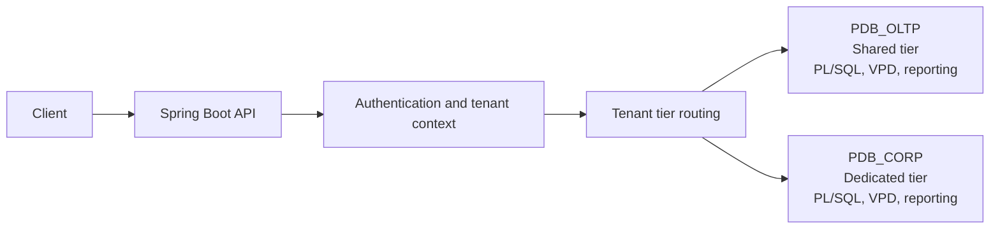
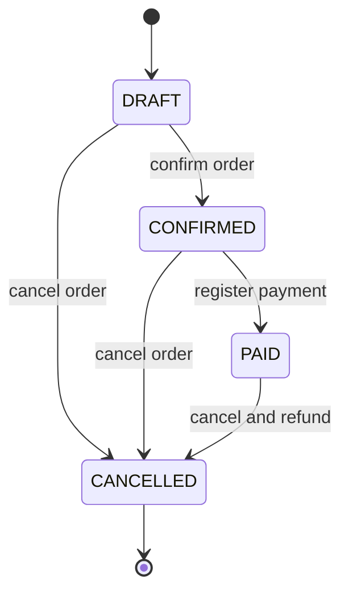
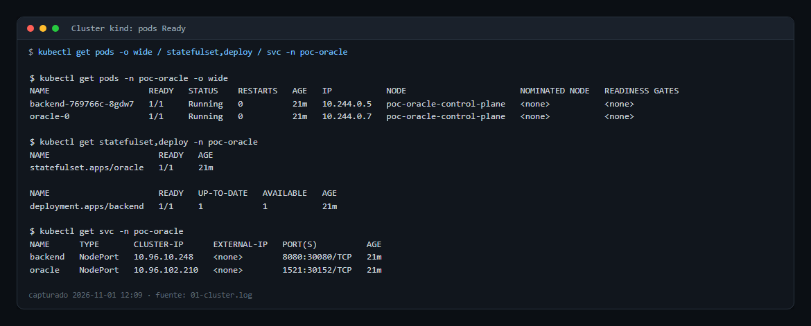
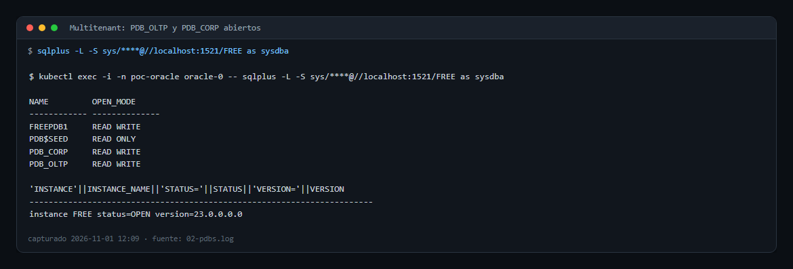
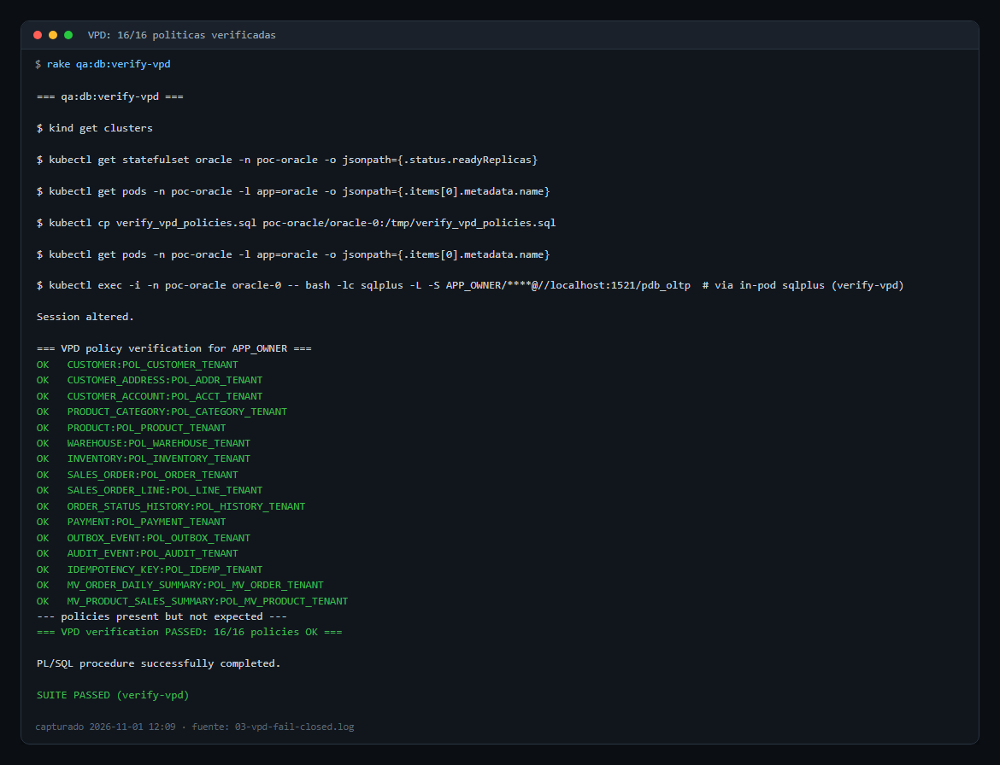
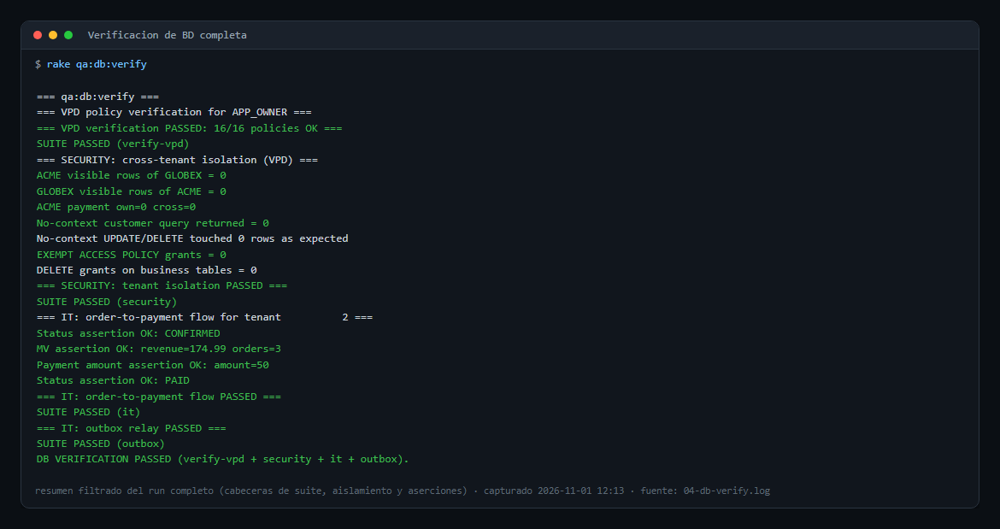
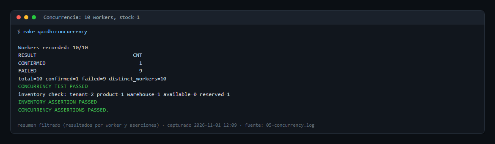
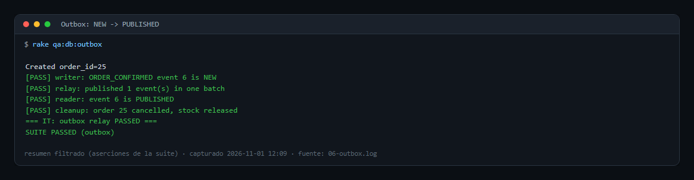
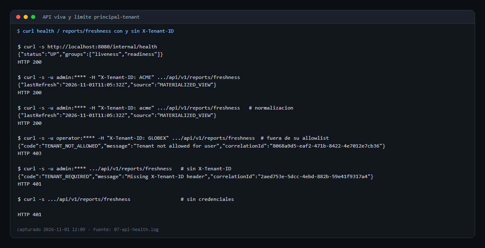

<div align="center">

# Multi-Tenant Order Management on Oracle Database 23c

**🗃️ Multi-Tenancy · 🔷 Hexagonal Architecture · ⚡ PL/SQL · 🔒 VPD · 🔄 Idempotency · 📦 Transactional Outbox**

[](https://openjdk.org/projects/jdk/21/)
[](https://spring.io/projects/spring-boot)
[](https://www.oracle.com/database/)
[](https://flywaydb.org/)
[](LICENSE)
[](https://podman.io/)

</div>

---

A proof-of-concept enterprise multi-tenant order management platform built on Oracle Database, demonstrating hexagonal architecture, database-level tenant isolation (VPD/DBMS_RLS), PL/SQL business logic, idempotent operations, transactional outbox pattern, and materialized view reporting — showcasing Oracle as a full enterprise application platform.

## ⚠️ Disclaimer

> This project is an **educational and research proof of concept** exploring **Oracle Database as an application platform**, **hexagonal architecture**, **multi-tenancy patterns**, and **enterprise integration** in a local lab.

The primary focus is to explore **PL/SQL business logic close to data**, **database-level security (VPD)**, **connection pooling (UCP)**, **idempotent operations**, and **transactional outbox patterns** — emphasizing developer learning and architectural exploration in a controlled environment.

---

## 🏗️ High-Level Architecture



## 🗃️ Why Oracle Database?

Oracle Database was chosen as the core platform for this POC for deliberate reasons that align with enterprise-grade application requirements:

### 🖥️ Database as Application Platform

Unlike traditional CRUD-over-HTTP architectures, this POC pushes business logic **into the database** via PL/SQL packages. The `confirm_order` procedure atomically validates, locks inventory (`SELECT FOR UPDATE`), reserves stock, transitions status, writes audit events, and writes outbox events — all in a single database transaction. This eliminates distributed transaction complexity and ensures ACID guarantees across all business operations.

### 🔐 Multi-Tenancy at the Database Layer

Oracle VPD (Virtual Private Database) / DBMS_RLS provides **invisible, fail-closed tenant isolation** at the database level. Statements against protected objects use the current tenant context, adding a database-level guard against cross-tenant access. The predicate `SYS_CONTEXT('APP_CTX','TENANT_ID') = tenant_id` is enforced on all 14 tenant-aware tables plus both materialized views (16 VPD objects).

### 🔗 Connection Pooling Without ORM

Oracle UCP (Universal Connection Pool) with explicit JDBC eliminates the overhead and opacity of JPA/Hibernate. Every SQL call is visible, every PL/SQL invocation is explicit, and the connection lifecycle (including VPD context setup and cleanup) is fully controlled by the application.

### ⚡ Concurrency Control

Pessimistic locking via `SELECT FOR UPDATE WAIT 5` in PL/SQL prevents overselling inventory under concurrent load, and a lock that cannot be acquired in 5 seconds fails as an actionable `409 LOCK_TIMEOUT` instead of hanging a request (and a pooled connection) forever. The concurrency test demonstrates that with exactly 1 unit of stock and N parallel workers, exactly 1 worker confirms successfully while all others fail with `INSUFFICIENT_INVENTORY`.

---

## 💪 Project Highlights

### ✅ Strengths

| Aspect | Detail |
|---|---|
| 🔐 **Database-level multi-tenancy** | VPD/DBMS_RLS on 16 objects provides invisible, fail-closed tenant filtering at the database layer. |
| ⚡ **Atomic business logic** | PL/SQL `confirm_order` procedure: validates + locks + reserves + transitions + audits + outbox in one transaction. PL/SQL is the authoritative implementation of order state changes. |
| 🔷 **Hexagonal architecture** | Clean port/adapter separation enforced by ArchUnit (15 rules). Controllers depend on use case interfaces, services depend on repository interfaces. Ports carry neutral business models (`OrderBO`, `TenantBO`); controllers map them to DTOs with MapStruct (wire JSON unchanged). Error-code→HTTP mapping is centralized in `GlobalExceptionHandler` (the tenant filter serializes its own path errors through `statusFor`). |
| 🔄 **Idempotent operations** | Create, confirm, cancel, and payment operations accept `Idempotency-Key` and safely handle retries, with a bounded replay window and a retention purge. |
| 📦 **Transactional outbox** | PL/SQL writes outbox events in the same transaction as business mutations; `pkg_outbox` relays them with `SKIP LOCKED`. |
| 🛡️ **Pessimistic locking** | `SELECT FOR UPDATE` on inventory prevents overselling. Concurrency test proves exactly-1-of-N success with stock=1. |
| 👤 **Least privilege** | Three Oracle users: `APP_OWNER` (DDL), `APP_RUNTIME` (DML via packages + idempotency only), `APP_REPORTING` (read-only: SELECT + tenant/VPD + refresh proc). |
| 📊 **Materialized Views** | OLTP-reporting separation via `MV_ORDER_DAILY_SUMMARY` and `MV_PRODUCT_SALES_SUMMARY` with on-demand refresh. |
| 🔭 **Observability** | Correlation ID propagation, structured JSON logging, Prometheus metrics via Micrometer. |
| 🔗 **Connection pooling** | Oracle UCP with validation-on-borrow, connection timeouts, and automatic tenant context setup/cleanup. |
| ⚙️ **Profile-based config** | Local/prod profiles with externalized secrets via environment variables. |

## 🧠 Design Decisions

### 🔷 Hexagonal Architecture (Ports & Adapters)

The backend follows hexagonal architecture with strict dependency direction:


- 📡 **Input ports** define what the application can do (use case interfaces per module)
- **📤 Output ports** define what the application needs (repository interfaces + `RateLimiterPort`), carrying neutral model types
- **🗃️ Adapters** implement the ports (REST controllers, JDBC DAOs, `TenantAwareDataSource`, rate limiter)
- **📦 Models** (`model/` + reporting `port/output/dto`) are framework-neutral; controllers map them to DTOs (wire JSON unchanged); `execution/` carries the `ExecutionContext` port

This allows swapping the JDBC adapter for an in-memory adapter in tests without modifying the service layer.

### 📡 JDBC Over JPA

JPA/Hibernate was deliberately excluded. The POC demonstrates:

- 🎯 Explicit SQL control for Oracle-specific features (FOR UPDATE, PL/SQL calls, VPD)
- 📞 Direct `CallableStatement` usage for stored procedure invocation
- 🔍 No hidden SQL generation — every query is visible and auditable
- 🔗 Connection-level tenant context management (`TenantAwareDataSource`)

### 🔒 VPD Over Application-Level Filtering

Tenant isolation is enforced at the database level, not in application code.

A statement with a missing or non-numeric tenant context returns zero rows (fail-closed), and `pkg_tenant.set_tenant_context` now rejects unknown or inactive tenants instead of storing an arbitrary number.

**Scope of the guarantee (stated precisely):** VPD eliminates the *forgotten `WHERE` clause* class of leak. It is not a defense against arbitrary SQL execution: a session that can run PL/SQL can call the context setter with another tenant id. The real principal↔tenant binding is the application boundary (`TenantContextFilter` + `operator-allowed-tenants`), and the runtime isolation boundary is `APP_RUNTIME`/`APP_REPORTING`. `APP_OWNER` holds `EXEMPT ACCESS POLICY` because Oracle requires it to create and refresh materialized views over VPD-protected masters — the owner is a deployment identity, not a runtime one.

### 🔄 Idempotency at the Database Level

The `IDEMPOTENCY_KEY` table with a unique constraint per tenant prevents duplicate operations. The key is **bound to operation + aggregateId + request fingerprint**: reusing it against a different operation, aggregate, or payload returns `409 IDEMPOTENCY_KEY_CONFLICT`.

Idempotency is a **bounded** cache, not an eternal one:

- `COMPLETED` rows are replayed only inside `app.idempotency.retention-days` (default 30). Older rows return `410 IDEMPOTENCY_KEY_EXPIRED`, because the stored response is a historical snapshot — replaying “confirmed” for an order cancelled weeks ago would be a lie.
- `pkg_idempotency.purge_expired` (definer's rights, invoked by the maintenance scheduler) deletes expired `COMPLETED` rows and stale `PENDING` rows. A `PENDING` row older than a day is a crashed request and must not answer retries with `409 IDEMPOTENCY_IN_PROGRESS` forever.

### 📦 Transactional Outbox Pattern

Outbox events are written by PL/SQL **within the same transaction** as business mutations, and `pkg_outbox.relay_once` closes the loop:

- Claims a bounded batch with `FOR UPDATE SKIP LOCKED` (concurrent relays skip each other's rows instead of blocking).
- The batch is bounded with `ROWNUM`, not `FETCH FIRST`: Oracle rejects `FETCH FIRST … FOR UPDATE` with `ORA-02014` (row limiting wraps the query in a view, and rows of a row-window view cannot be locked). The batch is therefore "up to N `NEW` rows", not "the N oldest" — publish order carries no meaning while the sink is a no-op.
- Drives `NEW → PROCESSING → PUBLISHED` in one transaction, so a crash leaves events `NEW` and the next run retries them (at-least-once).
- There is no broker in this POC: the publish step is a no-op sink, but the state transitions are real rows and are exercised end to end.
- The relay is a cross-tenant maintenance operation, so it runs through definer's-rights PL/SQL (same model as `refresh_reporting_views`), driven by `MaintenanceScheduler`.

---

## 🏗️ Architecture — Request Flow

An authenticated request passes through the correlation and tenant filters before reaching the REST controller. The application resolves the tenant, selects its PDB, and sets the Oracle session context through `TenantAwareDataSource`. VPD applies the tenant predicate to protected SQL operations.

---

## ✨ Features

### 🔐 Multi-Tenancy with VPD (Virtual Private Database)

Tenant isolation is enforced at the database level using Oracle VPD/DBMS_RLS:

- 🗃️ **16 VPD policies** on tenant-aware tables (customer, product, inventory, orders, payments, audit, outbox, idempotency key, materialized views, …) — V011/V013–V015, asserted by `database/security/verify_vpd_policies.sql`
- 🚫 **`TENANT` table has no VPD policy** — required for tenant resolution before context exists
- 🔒 **Fail-closed predicate**: Without `SYS_CONTEXT('APP_CTX','TENANT_ID')`, queries return zero rows
- 🤖 **Automatic filtering**: Queries and data changes on protected objects are scoped to the current tenant
- 📊 **Materialized views** carry VPD policies without `sec_relevant_cols` — always applied
- 🛡️ **Defense-in-depth, precisely scoped**: VPD makes a missing context return zero rows and rejects unknown/inactive tenants; it does not substitute for principal↔tenant binding (enforced at the application boundary) nor for input handling. See “Scope of the guarantee” above.

### 📋 Order Lifecycle Management

Order transitions are enforced by the `pkg_order_management` PL/SQL package.



### 🛡️ Inventory Concurrency Control

Pessimistic locking prevents overselling:

- 🔒 `SELECT FOR UPDATE WAIT 5` in `pkg_inventory.reserve_stock` locks the inventory row
- ⏳ Concurrent transactions queue on the lock — only one can reserve; a lock held longer than 5 s returns `409 LOCK_TIMEOUT` instead of blocking the request thread indefinitely
- 🧭 Lines are processed in `product_id` order, so lock acquisition order is deterministic and deadlocks are rare; `ORA-00060` still maps to `409 CONCURRENT_MODIFICATION`
- ✅ `CHECK` constraint ensures `available_quantity >= 0`
- 🧪 Concurrency test: stock=1, N workers → exactly 1 confirms, rest fail with `INSUFFICIENT_INVENTORY`

### 🔄 Idempotent Operations

Critical operations are idempotent via `idempotency_key` table:

- 📨 `create`, `confirm`, `cancel` and `register_payment` accept `Idempotency-Key` header (create returns `201` + `Location`); `OrderResponseDTO` carries `lines` and no `tenantId`; cancel rejects `SHIPPED` (409) and blank reason (400)
- 📝 First execution: insert PENDING → execute → mark COMPLETED in the same transaction
- 🔁 Retry with the same key returns the stored result without re-executing the operation
- 🔒 Key is bound to **operation + aggregateId + request fingerprint** — misuse returns `409 IDEMPOTENCY_KEY_CONFLICT`
- ⏳ **Bounded replay window**: `COMPLETED` keys older than `app.idempotency.retention-days` (30) return `410 IDEMPOTENCY_KEY_EXPIRED`; a maintenance job purges them
- ⚠️ Known trade-off: a *concurrent* duplicate waits on the unique index (no fast 409 for in-flight keys). Under aggressive client retries this can hold pool connections; see “Known limitations”

### 📦 Transactional Outbox Pattern

Transactional event records without distributed transactions:

- 📦 Outbox events written by PL/SQL **within the same transaction** as business mutations
- 🔗 No dual-write problem — outbox and business data are always consistent
- 🔁 Relay side implemented: `pkg_outbox.relay_once` claims events with `FOR UPDATE SKIP LOCKED` and drives `NEW → PROCESSING → PUBLISHED` (no broker: the publish step is a no-op sink)

### 📊 Materialized View Reporting

OLTP-reporting separation via Oracle Materialized Views:

- 📊 `MV_ORDER_DAILY_SUMMARY`: daily order counts, revenue, average order value
- 📊 `MV_PRODUCT_SALES_SUMMARY`: product sales ranking with period aggregation
- 🔄 Complete refresh on demand via `DBMS_MVIEW.REFRESH` (definer's-rights proc, context-free)
- ⏱️ Rate-limited refresh (configurable cooldown `app.reporting.refresh-cooldown-seconds`, default 60s) with refund on failure; `limit` `@Min(1)/@Max(100)`
- 🆕 Freshness signal: `GET /api/v1/reports/freshness` + `X-MV-Last-Refresh` header on report GETs
- 🔒 VPD-protected — reporting is automatically tenant-isolated

### 🔭 Observability

Enterprise-grade observability stack:

- 🔗 **Correlation ID**: `X-Correlation-ID` validated (`[A-Za-z0-9._-]{1,64}`, generated when missing/invalid), propagated through filters, MDC, and database calls
- 📝 **Structured logging**: JSON format with timestamp, level, service, thread, correlationId, tenantId
- 🏥 **Health**: `GET /internal/health**` (actuator base-path `/internal`, permitAll; no `/actuator/**` path)
- 📊 **Prometheus metrics**: `GET /internal/prometheus` (authenticated) via Micrometer + Actuator
- 🗄️ **PL/SQL audit trail**: `audit_event` table records all state transitions with actor and correlation ID

---

## ⚙️ Configuration Reference

### 📋 Application Configuration

| Property | Env Var | Default | Description |
|----------|---------|---------|-------------|
| `oracle.url` | `ORACLE_URL` | `jdbc:oracle:thin:@localhost:1521/pdb_oltp` | 🔗 Oracle connection URL |
| `oracle.dedicated-url` | `ORACLE_DEDICATED_URL` | local: `jdbc:oracle:thin:@localhost:1521/pdb_corp`; prod: required | 🏢 Dedicated PDB connection; prod must explicitly point at PDB_CORP |
| `oracle.username` | `ORACLE_USER` | `APP_RUNTIME` | 👤 Database username |
| `oracle.password` | `ORACLE_PASSWORD` | — (required) | 🔑 Database password |
| `oracle.ucp.max-pool-size` | — | `20` | 📊 Maximum connection pool size |
| `oracle.ucp.abandoned-connection-timeout` | — | `60` | 🧹 Backstop for stale sessions |
| `oracle.ucp.connection-validation-timeout` | — | `10` | ✅ Validation timeout |
| `app.reporting.refresh-cooldown-seconds` | — | `60` | ⏱️ MV refresh cooldown |
| `app.maintenance.enabled` | `APP_MAINTENANCE_ENABLED` | `false` local / `true` prod | 🔁 Enables outbox relay + idempotency retention jobs |
| `app.maintenance.outbox-interval-ms` | — | `30000` | ⏲️ Outbox relay interval |
| `app.maintenance.outbox-batch-size` | — | `100` | 📦 Events claimed per relay run |
| `app.maintenance.idempotency-purge-interval-ms` | — | `3600000` | 🧹 Retention purge interval |
| `app.idempotency.retention-days` | `APP_IDEMPOTENCY_RETENTION_DAYS` | `30` | ⏳ Replay window; older keys return `410` |
| `app.security.tenancy.operator-allowed-tenants` | `APP_OPERATOR_TENANTS` | `ACME` | 👤 Non-admin tenant binding (ADMIN: any) |
| `app.security.admin.password` | `APP_ADMIN_PASSWORD` | `changeme` (local only; prod requires env, fail-fast) | 🔑 Admin user password (HTTP Basic `admin`) |
| `app.security.operator.password` | `APP_OPERATOR_PASSWORD` | `changeme` (local only; prod requires env, fail-fast) | 🔑 Operator user password (HTTP Basic `operator`) |
| `flyway.*` | — | spring.flyway disabled at runtime | 🔄 Migrations via Maven plugin / rake (`flyway.user=APP_OWNER`, `filesystem:../database/migrations`, run from `backend/`) |

### 🐳 Container Configuration

gvenzl/oracle-free supported variables:

| Variable | Default | Description |
|----------|---------|-------------|
| `ORACLE_PASSWORD` | — (required) | 🔑 SYS/SYSTEM password (first start) |
| `ORACLE_DATABASE` | `PDB_OLTP` | 📦 Custom PDB created on first start (matches `jdbc:oracle:thin:@localhost:1521/pdb_oltp`) |
| `ORACLE_LISTENER_PORT` | `1521` | 🌐 Oracle listener port |

Init scripts are mounted at `/container-entrypoint-initdb.d` and run as SYS on first start.

---

## 🧪 Testing

### 🚀 Run All Checks

```bash
cd backend
mvn clean test
```

> The test suite covers application behavior, architecture rules, security configuration, and persistence adapters.

### 📋 Test Types

| Type | File | What It Tests |
|------|------|---------------|
| 🧪 Unit | `OrderServiceTest.java` | Order service logic, idempotency, tenant context |
| 🧪 Unit | `PlsqlErrorMapperTest.java` | Oracle error code → API error mapping (incl. `ORDER_ALREADY_PAID`, `PAYMENT_AMOUNT_INVALID`, `PAYMENT_CURRENCY_MISMATCH`, `ORDER_SHIPPED_NOT_CANCELLABLE`) |
| 🧪 Unit | `GlobalExceptionHandlerTest.java` | Exception → JSON error response mapping |
| 🧪 Unit | Additional test classes | Controllers, filters, DAOs, tenant context, reporting, rate limiter, architecture, and security configuration |
| 🔗 Integration | `IT_order_to_payment.sql` | Full lifecycle: create → confirm → pay → MV refresh → assert |
| ⚡ Concurrency | `rake qa:db:concurrency` | N workers compete for 1 stock unit → exactly 1 confirms |
| 🔒 Security | `T_security_tenant_isolation.sql` | VPD: tenant 1 cannot see tenant 2 data |

### 📊 Test Coverage

JaCoCo generates coverage reports at `backend/target/site/jacoco` after `mvn test`.

### ⚡ Concurrency Test

```bash
# From repo root (NOT cd tests/concurrency)
rake qa:db:concurrency
```

> Verifies pessimistic locking: with stock=1 and 5 parallel workers, exactly 1 worker confirms. SQL helpers are in `tests/concurrency/`; the Rake task manages the workers and cleanup.

### 🔒 Security Test

```sql
-- Connect as APP_RUNTIME and run:
@tests/security/T_security_tenant_isolation.sql
```

> Verifies VPD isolation: tenant 1 cannot see tenant 2 data, and no-context returns zero rows.

---

## 📁 Project Structure

```
poc_oracle/
├── 📄 README.md
├── 📄 LICENSE
├── ☕ backend/
│   ├── 📦 pom.xml                          # Maven build (Spring Boot 3.3.5, Java 21)
│   ├── 🐳 Dockerfile                       # Multi-stage: Maven build + JRE 21 runtime
│   └── 📂 src/
│       ├── 📂 main/java/.../
│       │   ├── ⚙️ config/                  # OracleUcpConfig, TenantAwareDataSource, SecurityConfig, FilterOrderConfig, CredentialHardeningCheck
│       │   ├── 🔍 tenant/                  # adapter/web(+mapper)|persistence|security, application, port/input|output, dto, model (TenantBO/NewTenantBO)
│       │   ├── 📋 order/                   # adapter/web(+mapper)|persistence, application (incl. IdempotentOperationExecutor), port/input|output, dto, model (OrderBO)
│       │   │   └── 📤 port/                # Input (use cases) / Output (repositories)
│       │   ├── 📊 reporting/               # adapter/web|persistence, application, port/input|output(+dto), ratelimiter/
│       │   ├── 📤 outbox/                  # port/output + adapter/persistence (relay of pkg_outbox)
│       │   ├── 💎 common/domain/           # Shared domain values and enums
│       │   ├── ⚠️ exception/               # BusinessException (HttpStatus), DatabaseException, PlsqlErrorMapper
│       │   ├── 🌐 web/                     # CorrelationFilter, GlobalExceptionHandler, ApiError
│       │   ├── 📦 execution/               # ExecutionContext port (+ MDC bridge)
│       ├── 📂 main/resources/
│       │   ├── 📄 application.yml          # Main config (spring.flyway.enabled=false; local profile)
│       │   └── 📄 application-prod.yml     # Production profile (requires env passwords, no defaults)
│       └── 📂 test/java/.../               # Application and ArchUnit tests (JaCoCo report under target/site/jacoco)
├── 🗄️ database/
│   ├── 📂 migrations/                      # Flyway-versioned database schema
│   ├── 📂 packages/                        # PL/SQL package specs (pks_*) + bodies (pkb_*) + deploy script
│   ├── 📂 backup/                          # RMAN backup and restore scripts
│   ├── 🔒 security/                        # VPD predicate function + policy application + verify_vpd_policies.sql (16 policies)
│   └── 🌱 seed/                            # Idempotent seed (3 tenants, products, inventory for all products,
│                                            #   multi-line demo order SO-ACME-0002, per-tenant VPD context)
├── 🏗️ infrastructure/
│   ├── 🐳 podman/
│   │   ├── 📄 .env.example                 # Environment variable template
│   │   └── 📜 scripts/01-init-db.sql       # First-startup DB setup (users, grants)
│   └── 🌐 networking/                      # Network topology documentation
├── 🧪 tests/
│   ├── 🔗 integration/                     # End-to-end order-to-payment flow
│   ├── ⚡ concurrency/                     # C_* worker/setup/assert SQL helpers; run with rake qa:db:concurrency
│   ├── 🔒 security/                        # VPD cross-tenant isolation test (both directions + privilege asserts)
│   ├── 📈 performance/                     # Performance workloads
│   └── 🛡️ resilience/                      # Backend, database, pool, and VPD scenarios
└── 🖼️ screenshots/                         # Captured evidence from a real lab run (kind + Podman + Oracle Free)
```

---

## 🚀 Quick Start

The supported lab runs on a dedicated local **kind** cluster using Podman as its container provider. It provisions Oracle PDB_OLTP (shared/VPD) and PDB_CORP (dedicated tier), and applies the same Flyway migrations, packages, and seed data to both PDBs.

Prerequisites: Podman with its machine running, kind, kubectl, Ruby/Rake, and Maven 3.9+. From the repository root:

```sh
cp infrastructure/podman/.env.example infrastructure/podman/.env
# Set lab credentials in infrastructure/podman/.env before first use.
rake qa:up
rake qa:db:init
rake qa:wait
rake qa:smoke
```

`rake qa:up` creates the `poc-oracle` cluster and deploys the images. `qa:db:init` migrates, deploys packages, and seeds both PDBs; `qa:wait` waits for the backend to become ready after schema initialization. See [QA on Kubernetes](#-qa-on-kubernetes-kind--podman) for teardown, database checks, E2E, concurrency, resilience, and performance tasks.

---

## 🎯 Demo Flow

1. 🏢 **Create tenant** — `POST /api/v1/tenants` requires role **ADMIN** (`-u admin:changeme` locally); ACME, GLOBEX, INITECH are seeded automatically
2. 📦 **Create order** — `POST /api/v1/orders` with customer and currency (201 + `Location`; accepts `Idempotency-Key`)
3. 📝 **Add order lines** — `POST /api/v1/orders/{id}/lines` (multi-line orders) while the order is `DRAFT` or `PENDING`
4. ✅ **Confirm order** — `POST /api/v1/orders/{id}/confirm` (reserves inventory atomically; lifecycle enforced by PL/SQL)
5. 💳 **Register payment** — `POST /api/v1/orders/{id}/payments` (idempotent by payment reference; must equal order total)
6. 🔄 **Refresh materialized views** — `POST /api/v1/reports/refresh` (ADMIN role required; cooldown-guarded)
7. 📊 **Query reports** — `GET /api/v1/reports/orders/daily`, `GET /api/v1/reports/products/top?limit=N` and `GET /api/v1/reports/freshness` (report GETs carry `X-MV-Last-Refresh`)
8. 🔐 **Verify tenant isolation** — authenticated principal + `X-Tenant-ID` binding (operator limited to allowed tenants); different tenants see different data
9. ⚡ **Run concurrency test** — prove pessimistic locking with parallel workers
10. 🧪 **Run security test** — prove VPD blocks cross-tenant access

> 🌱 Seed data includes inventory for **all** products and a multi-line demo order **SO-ACME-0002** (seed runs with per-tenant VPD context).

---

## 🧪 QA on Kubernetes (kind + Podman)

Repeatable QA runs on the local kind cluster. The whole flow is scripted in the `Rakefile` (`rake -T` lists all tasks; run from the repo root).

> 🔑 **The QA cluster intentionally runs the `local` Spring profile** with in-memory users and lab credentials (`admin:changeme`). Kind port mappings bind to `127.0.0.1` only. The `prod` profile (env-only secrets, fail-fast on weak passwords) is demonstrated by code and unit tests, not deployed in this lab.

### Prerequisites

- 🐳 Podman (with machine running), `kind`, `kubectl`, `rake` (Ruby), Maven 3.9+
- 🆓 Free host ports `8080` (backend) and `1521` (Oracle NodePort)
- 💾 ~5 GB free RAM (kind node + Oracle 2–3 GB + backend)
- 📄 `infrastructure/podman/.env` (copy from `.env.example`; lab passwords only)

### Bring-up

```bash
rake qa:cluster:create   # kind cluster 'poc-oracle' (Podman provider)
rake qa:image:build      # backend image via Podman (multi-stage Dockerfile)
rake qa:image:load       # load image into the kind node (via tarball)
rake qa:deploy           # namespace + secrets + Oracle StatefulSet + backend
rake qa:db:init          # flyway migrate (V001-V027) + PL/SQL packages + seed
rake qa:wait             # until Oracle + backend rollout are Ready
rake qa:smoke            # API health, authorization, order flow, refresh, tenant access, metrics
rake qa:db:verify        # DB verification: 16 VPD policies + tenant isolation + order-to-payment + outbox relay
rake e2e:all             # DB E01-E06 + API physical routing (backend must be up)
```

**First boot is slow, and that is expected.** Oracle Free creates and opens the database inside the container: on a 4-vCPU host it takes ~10–11 min from `qa:deploy` until the StatefulSet reports `Ready`. Two settings exist precisely because of that:

- every `db:*` task waits `QA_ORACLE_TIMEOUT` seconds (default `1200`) for Oracle; raise it on slower machines;
- the Oracle `startupProbe` allows 20 min for the same reason — a shorter budget makes kubelet kill the container mid-creation and leave a half-built datafile set on the PVC.

The backend starts before Oracle on purpose and simply reports Unready until the pool can connect; that is the fail-closed behaviour, not a crash loop.

### DB test suites (run in the Oracle pod, which ships sqlplus)

```bash
# Copy a suite into the pod and run it (APP_RUNTIME for IT/security):
kubectl cp tests/integration/IT_order_to_payment.sql poc-oracle/oracle-0:/tmp/it.sql
kubectl exec -n poc-oracle oracle-0 -- bash -lc \
  "sqlplus -L -S app_runtime/\$APP_RUNTIME_PWD@//localhost:1521/pdb_oltp @/tmp/it.sql"

# Concurrency: competing workers reserve a single stock unit
rake qa:db:concurrency   # QA_WORKERS=10 by default; restores stock to 100 afterwards
```

### Verification commands

| Check | Command | Coverage |
|---|---|---|
| Backend tests | `cd backend && mvn test` | Java application tests |
| API smoke checks | `rake qa:smoke` | Health, authentication, order flow, and tenant access |
| Database verification | `rake qa:db:verify` | VPD policies, tenant isolation, order-to-payment flow, and outbox relay |
| End-to-end scenarios | `rake e2e:all` | Database behavior and physical PDB routing |
| Inventory concurrency | `rake qa:db:concurrency` | Concurrent reservations against limited stock |

### Oracle Database Roles

| Role | Responsibility |
|---|---|
| `APP_OWNER` | Owns schema objects and deploys migrations and PL/SQL packages. |
| `APP_RUNTIME` | Executes application operations with tenant policies applied. |
| `APP_REPORTING` | Reads tenant-filtered reporting data and invokes the refresh procedure. |
| `SYS` | Creates the application users and grants during database initialization. |

---

## 🛠️ Technology Stack

### ☕ Application Layer

| Component | Technology | Version |
|-----------|-----------|---------|
| 🗣️ Language | Java | 21 (LTS) |
| 🚀 Framework | Spring Boot | 3.3.5 |
| 🌐 Web | Spring MVC (REST) | (managed) |
| 🛡️ Security | Spring Security (HTTP Basic, principal+tenant binding) | (managed) |
| 🗃️ Persistence | Spring JDBC + PL/SQL | (managed) |
| ✅ Validation | Jakarta Validation | (managed) |
| 🔭 Observability | Spring Actuator + Micrometer | (managed) |
| 📦 Build | Maven | 3.9+ |

### 🗄️ Database Layer

| Component | Technology | Version |
|-----------|-----------|---------|
| 🗄️ Database | Oracle Database Free | 23c |
| 📦 Multitenant | Oracle CDB/PDB | — |
| 🔗 Connection Pool | Oracle UCP | 23.4.0 |
| 📡 JDBC Driver | Oracle JDBC (ojdbc11) | 23.4.0 |
| 🔄 Migrations | Flyway | 10.20.1 |
| ⚡ Business Logic | PL/SQL Packages | — |
| 🔒 Isolation | VPD / DBMS_RLS | — |
| 📊 Reporting | Materialized Views | — |

### 🏗️ Infrastructure

| Component | Technology |
|-----------|-----------|
| 🐳 Containerization | Podman |
| 🏗️ Container Build | Multi-stage Dockerfile |
| 🗄️ Database Image | gvenzl/oracle-free:23-slim |

---

## 🖼️ Screenshots (real lab run)

Evidence captured from a live run of this commit on the `poc-oracle` kind cluster (Podman provider, Oracle Database Free 23c, PDB_OLTP + PDB_CORP, backend image built from source).

Each PNG is the raw log of the run rendered as a terminal, not a retyped transcript: the footer names the source log, and the three summarised pages state the exact filter applied. No command output was edited; `04`, `05` and `06` are line filters over the full log, so they show the verdicts and the assertions, not every `kubectl` echo.

| Evidence | What it shows |
|---|---|
|  | Oracle and backend pods Ready in `poc-oracle` |
|  | `PDB_OLTP` and `PDB_CORP` both open READ WRITE |
|  | All 16 VPD policies present, each on the table it guards |
|  | Four suites pass, including the fail-closed counters: no context → 0 rows, 0 `EXEMPT ACCESS POLICY` and 0 `DELETE` grants |
|  | stock=1, N workers → exactly one confirmation |
|  | Writer leaves the event `NEW`; the relay publishes it and the reader sees `PUBLISHED` |
|  | Live backend health/readiness |


## 📜 License

This project is licensed under the MIT License. See [LICENSE](LICENSE) for details.

The MIT license covers the code in this repository. It does not extend to third-party components pulled in at build or deploy time:

- **Oracle Database Free 23c** and the **Oracle JDBC driver / UCP** (`ojdbc11`, `ucp`) are governed by the *Oracle Free Distribution, Hosting, and Use Terms and Conditions*, not an OSI license. Those terms allow redistributing the unmodified programs subject to carrying the license text with them; the driver jar ships its own `META-INF/license.txt`, so an image built here satisfies that condition without extra steps. The repository itself vendors neither: Maven resolves the driver, and the database image is pulled at deploy time.
- The rest of the runtime classpath is Apache-2.0, plus `logback` (EPL-1.0 / LGPL-2.1), `jakarta.*` (EPL-2.0 or GPL-2.0 + Classpath Exception) and `LatencyUtils` (CC0). There is no AGPL, and nothing in that set imposes a copyleft obligation on this MIT code.
- The base runtime image is Temurin (GPL-2.0 + Classpath Exception), used unmodified.
- The passwords in `.env.example`, the Rakefile defaults and the seed data are documented **demo values**, not secrets. The `prod` profile refuses weak values and takes them from the environment.
