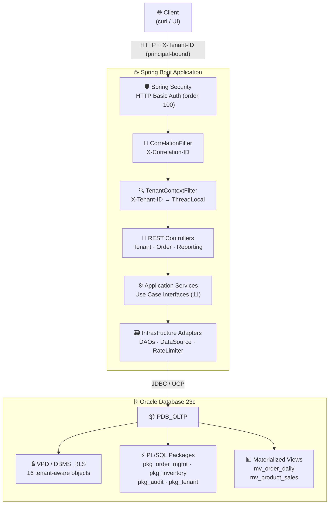
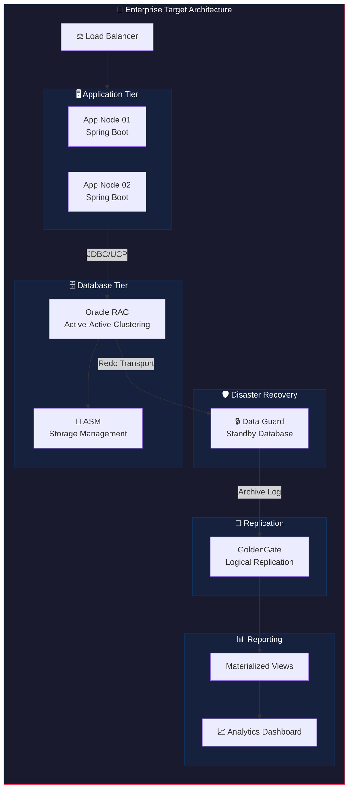
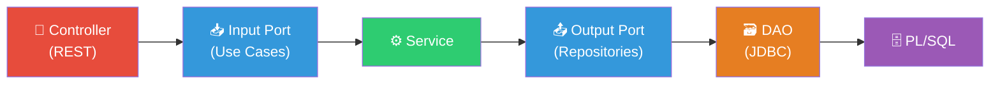
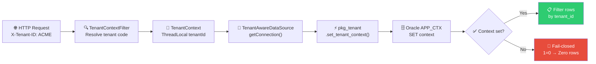
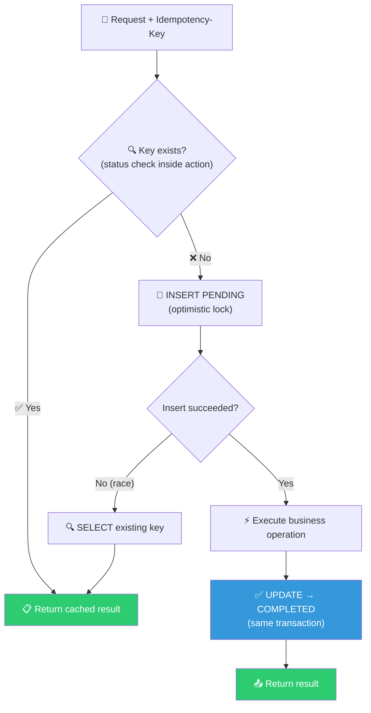
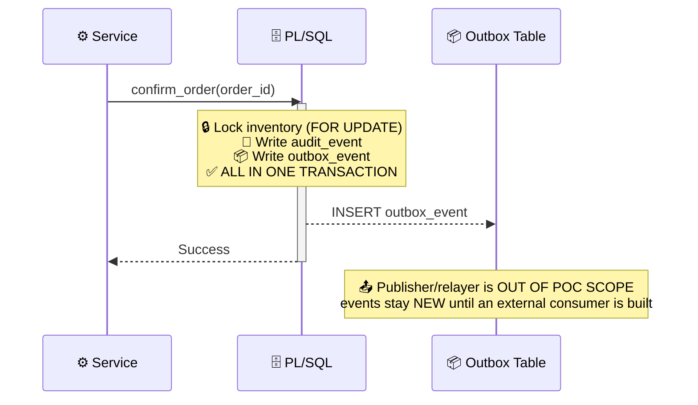
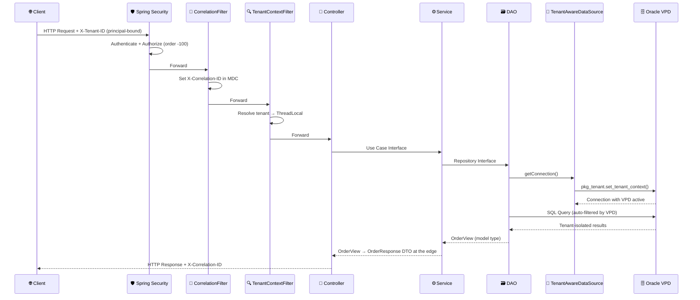
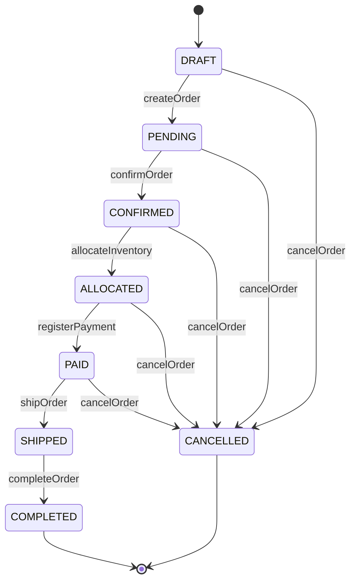

<div align="center">

# Resilient Enterprise Architecture on Oracle 23c: Zero Downtime, Active-Active Clustering & Disaster Recovery

**🗃️ Multi-Tenancy · 🔷 Hexagonal Architecture · ⚡ PL/SQL · 🔒 VPD · 🔄 Idempotency · 📦 Transactional Outbox**

[](https://openjdk.org/projects/jdk/21/)
[](https://spring.io/projects/spring-boot)
[](https://www.oracle.com/database/)
[](https://flywaydb.org/)
[](LICENSE)
[](https://podman.io/)

</div>

---

A proof-of-concept enterprise multi-tenant order management platform built on Oracle Database, demonstrating hexagonal architecture, database-level tenant isolation (VPD/DBMS_RLS), PL/SQL business logic, idempotent operations, transactional outbox pattern, and materialized view reporting — showcasing Oracle as a full enterprise application platform.

## ⚠️ Disclaimer

> This project is developed for **educational and research purposes** only. It is intended to provide hands-on experience and deepen knowledge in **Oracle Database as an application platform**, **hexagonal architecture**, **multi-tenancy patterns**, and **enterprise integration**. It is **not designed** for deployment in production environments.

The primary focus is to explore **PL/SQL business logic close to data**, **database-level security (VPD)**, **connection pooling (UCP)**, **idempotent operations**, and **transactional outbox patterns** — emphasizing developer learning and architectural exploration in a controlled environment.

---

## 🏗️ High-Level Architecture



> 🛡️ **Actual filter order**: Spring Security's filter chain runs at order `-100`, i.e. **before** the correlation (order `0`) and tenant (order `10`) servlet filters set in `FilterOrderConfig`. Requests are authenticated first, then correlation/tenant context is established.

## 🏢 Enterprise Target Architecture



---

## 🗃️ Why Oracle Database?

Oracle Database was chosen as the core platform for this POC for deliberate reasons that align with enterprise-grade application requirements:

### 🖥️ Database as Application Platform

Unlike traditional CRUD-over-HTTP architectures, this POC pushes business logic **into the database** via PL/SQL packages. The `confirm_order` procedure atomically validates, locks inventory (`SELECT FOR UPDATE`), reserves stock, transitions status, writes audit events, and writes outbox events — all in a single database transaction. This eliminates distributed transaction complexity and ensures ACID guarantees across all business operations.

### 🔐 Multi-Tenancy at the Database Layer

Oracle VPD (Virtual Private Database) / DBMS_RLS provides **invisible, fail-closed tenant isolation** at the database level. Every SQL statement is automatically filtered by tenant — no application code can accidentally leak data across tenants. The predicate `SYS_CONTEXT('APP_CTX','TENANT_ID') = tenant_id` is enforced on all 14 tenant-aware tables, including materialized views.

### 🔗 Connection Pooling Without ORM

Oracle UCP (Universal Connection Pool) with explicit JDBC eliminates the overhead and opacity of JPA/Hibernate. Every SQL call is visible, every PL/SQL invocation is explicit, and the connection lifecycle (including VPD context setup and cleanup) is fully controlled by the application.

### ⚡ Concurrency Control

Pessimistic locking via `SELECT FOR UPDATE` in PL/SQL prevents overselling inventory under concurrent load. The concurrency test demonstrates that with exactly 1 unit of stock and N parallel workers, exactly 1 worker confirms successfully while all others fail with `INSUFFICIENT_INVENTORY`.

---

## 💪 Strengths and Weaknesses

### ✅ Strengths

| Aspect | Detail |
|---|---|
| 🔐 **Database-level multi-tenancy** | VPD/DBMS_RLS on 16 objects — invisible, fail-closed isolation. No application code can leak cross-tenant data. |
| ⚡ **Atomic business logic** | PL/SQL `confirm_order` procedure: validates + locks + reserves + transitions + audits + outbox in one transaction. Java domain deleted — PL/SQL is the single authority. |
| 🔷 **Hexagonal architecture** | Clean port/adapter separation enforced by ArchUnit (15 rules). Controllers depend on use case interfaces, services depend on repository interfaces. Ports carry neutral model types (`OrderView`, `TenantView`); controllers map to DTOs (wire JSON unchanged). Error-code→HTTP mapping lives only in `GlobalExceptionHandler`. |
| 🔄 **Idempotent operations** | Create/confirm/cancel/payment accept `Idempotency-Key`; replay returns the ORIGINAL stored payload; PENDING→409, FAILED→re-execute. |
| 📦 **Transactional outbox** | Outbox events written atomically by PL/SQL within the same transaction as business mutations. Publisher/relayer is out of POC scope (see Known Limitations). |
| 🛡️ **Pessimistic locking** | `SELECT FOR UPDATE` on inventory prevents overselling. Concurrency test proves exactly-1-of-N success with stock=1. |
| 👤 **Least privilege** | Three Oracle users: `APP_OWNER` (DDL), `APP_RUNTIME` (DML via packages + idempotency only), `APP_REPORTING` (read-only: SELECT + tenant/VPD + refresh proc). |
| 📊 **Materialized Views** | OLTP-reporting separation via `MV_ORDER_DAILY_SUMMARY` and `MV_PRODUCT_SALES_SUMMARY` with on-demand refresh. |
| 🔭 **Observability** | Correlation ID propagation, structured JSON logging, Prometheus metrics via Micrometer. |
| 🔗 **Connection pooling** | Oracle UCP with validation-on-borrow, connection timeouts, and automatic tenant context setup/cleanup. |
| ⚙️ **Profile-based config** | Local/test/prod profiles with externalized secrets via environment variables. |

### ⚠️ Weaknesses / Tradeoffs

| Aspect | Detail |
|---|---|
| 📡 **No JPA/Hibernate** | Explicit JDBC requires more boilerplate but provides full SQL control. Tradeoff: developer productivity vs. transparency. |
| 🗄️ **PL/SQL business logic** | Database-centric logic is harder to version control and test locally. Mitigated by Flyway migrations and SQL-based tests. |
| 🖥️ **Single-instance Oracle Free** | No RAC, ASM, or Data Guard locally. Enterprise architecture is documented but not simulated. |
| 🔑 **In-memory credentials** | Spring Security uses `InMemoryUserDetailsManager`. A production setup would use LDAP/OAuth2. |
| 🔗 **No distributed tracing** | Correlation ID is propagated but not integrated with Jaeger/Zipkin. |
| 🔄 **GoldenGate not running** | Extract/Replicat configuration is documented but not deployed locally. |

---

## 🧠 Design Decisions

### 🔷 Hexagonal Architecture (Ports & Adapters)

The backend follows hexagonal architecture with strict dependency direction:



- 📡 **Input ports** define what the application can do (use case interfaces per module)
- **📤 Output ports** define what the application needs (repository interfaces + `RateLimiterPort`), carrying neutral model types
- **🗃️ Adapters** implement the ports (REST controllers, JDBC DAOs, `TenantAwareDataSource`, rate limiter)
- **📦 Models** (`model/` + reporting `port/output/dto`) are framework-neutral; controllers map them to DTOs (wire JSON unchanged); `execution/` carries the `ExecutionContext` port

This allows swapping the JDBC adapter for an in-memory adapter in tests without modifying the service layer.

### 📡 JDBC Over JPA (SRS §50)

JPA/Hibernate was deliberately excluded. The POC demonstrates:

- 🎯 Explicit SQL control for Oracle-specific features (FOR UPDATE, PL/SQL calls, VPD)
- 📞 Direct `CallableStatement` usage for stored procedure invocation
- 🔍 No hidden SQL generation — every query is visible and auditable
- 🔗 Connection-level tenant context management (`TenantAwareDataSource`)

### 🔒 VPD Over Application-Level Filtering (SRS §13, §52)

Tenant isolation is enforced at the database level, not in application code:



This means even a SQL injection vulnerability cannot leak cross-tenant data.

### 🔄 Idempotency at the Database Level (SRS §62, FR-014)

The `IDEMPOTENCY_KEY` table with unique constraint per tenant prevents duplicate operations:



The key is **bound to operation + aggregateId**: reusing a key against a different operation or aggregate returns `409 IDEMPOTENCY_KEY_CONFLICT`.

### 📦 Transactional Outbox Pattern (SRS §63)

Outbox events are written by PL/SQL **within the same transaction** as business mutations:



This guarantees atomic consistency — the outbox event cannot exist without the business mutation, and vice versa. **No component in this POC polls the outbox or marks events as PUBLISHED.**

---

## 🏗️ Architecture — Request Flow



---

## ✨ Features

### 🔐 Multi-Tenancy with VPD (Virtual Private Database)

Tenant isolation is enforced at the database level using Oracle VPD/DBMS_RLS:

- 🗃️ **16 VPD policies** on tenant-aware tables (customer, product, inventory, orders, payments, audit, outbox, idempotency key, materialized views, …) — V011/V013–V015, asserted by `database/security/verify_vpd_policies.sql`
- 🚫 **`TENANT` table has no VPD policy** — required for tenant resolution before context exists
- 🔒 **Fail-closed predicate**: Without `SYS_CONTEXT('APP_CTX','TENANT_ID')`, queries return zero rows
- 🤖 **Automatic filtering**: Every SQL statement (SELECT, INSERT, UPDATE, DELETE) is filtered by tenant
- 📊 **Materialized views** carry VPD policies without `sec_relevant_cols` — always applied
- 🛡️ **Defense-in-depth**: Even SQL injection cannot leak cross-tenant data

### 📋 Order Lifecycle Management

Complete order workflow with state machine enforcement:



- ✅ **PL/SQL (`pkg_order_management`) is the authoritative lifecycle** — status transitions are enforced there inside each procedure
- 🗑️ Java domain aggregate **deleted** — no `order/domain`, no `Money`/`Quantity` (PL/SQL is the single authority; `PaymentMethod` kept as literal enum + consistency test)
- ➕ **Multi-line orders**: order lines can be added while the order is `DRAFT` or `PENDING`
- ⚡ PL/SQL `confirm_order` atomically: validates → locks inventory → reserves stock → transitions status → writes audit → writes outbox
- 🔄 Idempotent create/confirm/cancel/payment operations prevent duplicate processing
- ⚠️ Error codes mapped from PL/SQL: `ORDER_ALREADY_PAID`, `PAYMENT_AMOUNT_INVALID`, `PAYMENT_AMOUNT_MISMATCH`, `INVALID_QUANTITY`, `STATUS_TRANSITION_CONFLICT`, `PAYMENT_CURRENCY_MISMATCH`, `ORDER_SHIPPED_NOT_CANCELLABLE`, `TENANT_NOT_ALLOWED`, `CANCEL_REASON_REQUIRED`, `IDEMPOTENCY_*`, `TENANT_CONTEXT_MISSING`

### 🛡️ Inventory Concurrency Control

Pessimistic locking prevents overselling:

- 🔒 `SELECT FOR UPDATE` in `pkg_inventory.reserve_stock` locks the inventory row
- ⏳ Concurrent transactions queue on the lock — only one can reserve
- ✅ `CHECK` constraint ensures `available_quantity >= 0`
- 🧪 Concurrency test: stock=1, N workers → exactly 1 confirms, rest fail with `INSUFFICIENT_INVENTORY`

### 🔄 Idempotent Operations

Critical operations are idempotent via `idempotency_key` table:

- 📨 `create`, `confirm`, `cancel` and `register_payment` accept `Idempotency-Key` header (create returns `201` + `Location`); `OrderResponse` carries `lines` and no `tenantId`; cancel rejects `SHIPPED` (409) and blank reason (400)
- 📝 First execution: insert PENDING → execute → mark COMPLETED (all in one transaction); the status check happens **inside** the idempotent action
- 🔁 Retry with the same key returns the cached result without re-execution
- 🔒 Key is bound to **operation + aggregateId** — misuse returns `409 IDEMPOTENCY_KEY_CONFLICT`; unique constraint per tenant prevents race conditions

### 📦 Transactional Outbox Pattern

Reliable event publishing without distributed transactions:

- 📦 Outbox events written by PL/SQL **within the same transaction** as business mutations
- 🔗 No dual-write problem — outbox and business data are always consistent
- 🚧 **Publisher/relayer is out of POC scope**: no component polls `outbox_event` or marks events as `PUBLISHED` (events remain `NEW`)

### 📊 Materialized View Reporting

OLTP-reporting separation via Oracle Materialized Views:

- 📊 `MV_ORDER_DAILY_SUMMARY`: daily order counts, revenue, average order value
- 📊 `MV_PRODUCT_SALES_SUMMARY`: product sales ranking with period aggregation
- 🔄 Complete refresh on demand via `DBMS_MVIEW.REFRESH` (definer's-rights proc, context-free)
- ⏱️ Rate-limited refresh (configurable cooldown `app.reporting.refresh-cooldown-seconds`, default 60s) with refund on failure; `limit` `@Min(1)/@Max(100)`
- 🆕 Freshness signal: `GET /api/v1/reports/freshness` + `X-MV-Last-Refresh` header on report GETs
- 🔒 VPD-protected — reporting is automatically tenant-isolated

### 🔭 Observability

Enterprise-grade observability stack:

- 🔗 **Correlation ID**: `X-Correlation-ID` validated (`[A-Za-z0-9._-]{1,64}`, generated when missing/invalid), propagated through filters, MDC, and database calls
- 📝 **Structured logging**: JSON format with timestamp, level, service, thread, correlationId, tenantId
- 🏥 **Health**: `GET /internal/health**` (actuator base-path `/internal`, permitAll; no `/actuator/**` path)
- 📊 **Prometheus metrics**: `GET /internal/prometheus` (authenticated) via Micrometer + Actuator
- 🗄️ **PL/SQL audit trail**: `audit_event` table records all state transitions with actor and correlation ID

---

## ⚙️ Configuration Reference

### 📋 Application Configuration

| Property | Env Var | Default | Description |
|----------|---------|---------|-------------|
| `oracle.url` | `ORACLE_URL` | `jdbc:oracle:thin:@localhost:1521/pdb_oltp` | 🔗 Oracle connection URL |
| `oracle.username` | `ORACLE_USER` | `APP_RUNTIME` | 👤 Database username |
| `oracle.password` | `ORACLE_PASSWORD` | — (required) | 🔑 Database password |
| `oracle.ucp.max-pool-size` | — | `20` | 📊 Maximum connection pool size |
| `oracle.ucp.abandoned-connection-timeout` | — | `60` | 🧹 Backstop for stale sessions |
| `oracle.ucp.connection-validation-timeout` | — | `10` | ✅ Validation timeout |
| `app.reporting.refresh-cooldown-seconds` | — | `60` | ⏱️ MV refresh cooldown |
| `app.security.tenancy.operator-allowed-tenants` | `APP_OPERATOR_TENANTS` | `ACME` | 👤 Non-admin tenant binding (ADMIN: any) |
| `app.security.admin.password` | `APP_ADMIN_PASSWORD` | `changeme` (local only; prod requires env, fail-fast) | 🔑 Admin user password (HTTP Basic `admin`) |
| `app.security.operator.password` | `APP_OPERATOR_PASSWORD` | `changeme` (local only; prod requires env, fail-fast) | 🔑 Operator user password (HTTP Basic `operator`) |
| `flyway.*` | — | spring.flyway disabled at runtime | 🔄 Migrations via Maven plugin / rake (`flyway.user=APP_OWNER`, `filesystem:../database/migrations`, run from `backend/`) |

### 🐳 Container Configuration

gvenzl/oracle-free supported variables:

| Variable | Default | Description |
|----------|---------|-------------|
| `ORACLE_PASSWORD` | — (required) | 🔑 SYS/SYSTEM password (first start) |
| `ORACLE_DATABASE` | `PDB_OLTP` | 📦 Custom PDB created on first start (matches `jdbc:oracle:thin:@localhost:1521/pdb_oltp`) |
| `ORACLE_LISTENER_PORT` | `1521` | 🌐 Oracle listener port |

> ⚠️ `ORACLE_SID` / `ORACLE_PDB` are **not** supported by gvenzl images — do not set. Init scripts are mounted at `/container-entrypoint-initdb.d` (executed as SYS on first start).

---

## 🧪 Testing

### 🚀 Run All Checks

```bash
cd backend
mvn clean test
```

> ✅ **248 tests in 22 test classes — 0 failures.** (incl. ArchUnit hexagonal rules, SecurityMatrixTest, CredentialHardeningCheckTest, OrderDaoTest, IdempotencyDaoTest, PaymentMethodConsistencyTest)

### 📋 Test Types

| Type | File | What It Tests |
|------|------|---------------|
| 🧪 Unit | `OrderServiceTest.java` | Order service logic, idempotency, tenant context |
| 🧪 Unit | `PlsqlErrorMapperTest.java` | Oracle error code → API error mapping (incl. `ORDER_ALREADY_PAID`, `PAYMENT_AMOUNT_INVALID`, `PAYMENT_CURRENCY_MISMATCH`, `ORDER_SHIPPED_NOT_CANCELLABLE`) |
| 🧪 Unit | `GlobalExceptionHandlerTest.java` | Exception → JSON error response mapping |
| 🧪 Unit | (17 more classes) | Controllers, filters, DAOs, tenant context, reporting, rate limiter, executor, ArchUnit, security matrix, credential hardening |
| 🔗 Integration | `IT_order_to_payment.sql` | Full lifecycle: create → confirm → pay → MV refresh → assert |
| ⚡ Concurrency | `run_concurrency_test.bat` | N workers compete for 1 stock unit → exactly 1 confirms |
| 🔒 Security | `T_security_tenant_isolation.sql` | VPD: tenant 1 cannot see tenant 2 data |

### 📊 Test Coverage

JaCoCo generates coverage reports at `backend/target/site/jacoco` (after `mvn test`); no coverage gate is enforced.

### ⚡ Concurrency Test

```bash
# From repo root (NOT cd tests/concurrency)
tests\concurrency\run_concurrency_test.bat
```

> Verifies pessimistic locking: with stock=1 and 5 parallel workers, exactly 1 worker confirms. Helper scripts in the same folder: `C_setup_stock.sql`, `C_concurrent_orders_worker.sql`, `C_worker_runner.bat`, `C_assert_results.sql`.

### 🔒 Security Test

```sql
-- Connect as APP_RUNTIME and run:
@tests/security/T_security_tenant_isolation.sql
```

> Verifies VPD isolation: tenant 1 cannot see tenant 2 data, and no-context returns zero rows.

---

## 📁 Project Structure

```
poc_oracle/
├── 📄 README.md
├── 📄 LICENSE
├── 📄 SRS.txt                              # Software Requirements Specification
├── ☕ backend/
│   ├── 📦 pom.xml                          # Maven build (Spring Boot 3.3.5, Java 21)
│   ├── 🐳 Dockerfile                       # Multi-stage: Maven build + JRE 21 runtime
│   └── 📂 src/
│       ├── 📂 main/java/.../
│       │   ├── ⚙️ config/                  # OracleUcpConfig, TenantAwareDataSource, SecurityConfig, FilterOrderConfig, CredentialHardeningCheck
│       │   ├── 🔍 tenant/                  # adapter/web|persistence|security, application, port/input|output, dto, model (TenantView/NewTenant)
│       │   ├── 📋 order/                   # adapter/web|persistence, application (incl. IdempotentOperationExecutor), port/input|output, dto, model (OrderView)
│       │   │   └── 📤 port/                # Input (use cases) / Output (repositories)
│       │   ├── 📊 reporting/               # adapter/web|persistence, application, port/input|output(+dto), ratelimiter/
│       │   ├── 💎 common/domain/           # OrderStatus, Currency, PaymentMethod (literals + consistency test; Money/Quantity deleted)
│       │   ├── ⚠️ exception/               # BusinessException (HttpStatus), DatabaseException, PlsqlErrorMapper
│       │   ├── 🌐 web/                     # CorrelationFilter, GlobalExceptionHandler, ApiError
│       │   ├── 📦 execution/               # ExecutionContext port (+ MDC bridge)
│       │   └── 🏛️ architecture/            # HexagonalArchitectureTest (ArchUnit, in test sources)
│       ├── 📂 main/resources/
│       │   ├── 📄 application.yml          # Main config (spring.flyway.enabled=false; local profile)
│       │   ├── 📄 application-test.yml     # Test profile
│       │   └── 📄 application-prod.yml     # Production profile (requires env passwords, no defaults)
│       └── 📂 test/java/.../               # 22 test classes / 248 tests (JaCoCo report under target/site/jacoco)
├── 🗄️ database/
│   ├── 📂 migrations/                      # 22 Flyway-versioned SQL files (V001-V022)
│   │                                        #   V019 reporting/runtime revoke · V020 reserved_warehouse_id · V021 outbox dedup · V022 payload 4000
│   ├── 📂 packages/                        # PL/SQL package specs (pks_*) + bodies (pkb_*) + deploy script
│   ├── 📂 backup/                          # RMAN scripts (rman_full_backup.rcv, rman_restore.bat, backup_verify.sql) — unexecuted live
│   ├── 🔒 security/                        # VPD predicate function + policy application + verify_vpd_policies.sql (16 policies)
│   └── 🌱 seed/                            # Idempotent seed (3 tenants, products, inventory for all products,
│                                            #   multi-line demo order SO-ACME-0002, per-tenant VPD context)
├── 🔄 goldengate/
│   ├── 📂 extract/                         # GGSCI extract group setup (.ggsci, no semicolons)
│   ├── 📂 replicat/                        # GGSCI replicat group setup (.ggsci, no semicolons)
│   ├── 📂 parameter-files/                 # Extract + replicat parameter files (RMTHOST/RMTTRAIL + USERIDALIAS ogg_admin)
│   └── 📂 docs/                            # GoldenGate architecture documentation (illustrative, not deployed locally)
├── 📚 docs/
│   ├── 📂 adr/                             # ADR-001..010 (hexagonal, VPD, PL/SQL, JDBC, idempotency/outbox, MV, UCP, auth, Flyway, session+grants)
│   ├── 📂 architecture/                    # 01-overview..06-observability
│   └── 📂 runbooks/                        # backup-restore, flashback, dataguard-switchover, goldengate
├── 🏗️ infrastructure/
│   ├── 🐳 podman/
│   │   ├── 📄 compose.yaml                 # Podman Compose: Oracle Free 23-slim
│   │   ├── 📄 .env.example                 # Environment variable template
│   │   └── 📜 scripts/01-init-db.sql       # First-startup DB setup (users, grants)
│   └── 🌐 networking/                      # Network topology documentation
└── 🧪 tests/
    ├── 🔗 integration/                     # End-to-end order-to-payment flow
    ├── ⚡ concurrency/                     # run_concurrency_test.bat + C_* worker/setup/assert helpers
    ├── 🔒 security/                        # VPD cross-tenant isolation test (both directions + privilege asserts)
    ├── 📈 performance/                     # P01-P06 workloads + run_performance.bat (SRS §107; unexecuted)
    └── 🛡️ resilience/                      # R01-R04 backend-kill/db-outage/pool-limits/VPD-absence (SRS §117; partial)
```

---

## 🚀 Quick Start

### 📋 Prerequisites

- 🐳 Podman (or Docker)
- ☕ Java 21+
- 📦 Maven 3.9+

### 1️⃣ Start Oracle Database

```bash
cd infrastructure/podman
cp .env.example .env    # Edit .env and set ORACLE_PASSWORD (and ORACLE_DATABASE=PDB_OLTP)
podman compose up -d
```

> ⏳ Wait ~90 seconds for Oracle to be ready (health check passes).
> Init scripts under `scripts/` are mounted at `/container-entrypoint-initdb.d` (run on first start as SYS).

### 2️⃣ Run Database Migrations

```bash
cd ../../backend
mvn flyway:migrate "-Dflyway.password=<APP_OWNER password>"
# Defaults: flyway.user=APP_OWNER, flyway.url=jdbc:oracle:thin:@localhost:1521/pdb_oltp,
# migrations from filesystem:../database/migrations (V001-V022).
# NOTE: spring.flyway is disabled at runtime — Maven/rake own migrations.
```

### 3️⃣ Deploy PL/SQL Packages

```bash
sqlplus APP_OWNER/<password>@localhost:1521/PDB_OLTP @database/packages/deploy_packages.sql
```

### 4️⃣ Start Application

```bash
mvn spring-boot:run
# Local defaults: admin / changeme (ADMIN) and operator / changeme (OPERATOR),
# overridable via APP_ADMIN_PASSWORD / APP_OPERATOR_PASSWORD.
# PROD has no defaults — startup fails fast without env passwords
# (CredentialHardeningCheck also rejects weak values).
# Tenant binding: operator may only use APP_OPERATOR_TENANTS (default ACME);
# GET /api/v1/tenants/** is ADMIN-only.
```

### 5️⃣ Verify

```bash
# 🏥 Health check (permitAll; actuator base-path is /internal, no /actuator/** path)
curl http://localhost:8080/internal/health

# 📦 Create order (requires ORDER_OPERATOR role + tenant binding)
curl -X POST http://localhost:8080/api/v1/orders \
  -H "Content-Type: application/json" \
  -H "X-Tenant-ID: ACME" \
  -u operator:changeme \
  -d '{"customerId":1,"currency":"USD"}'
```

---

## 🎯 Demo Flow

1. 🏢 **Create tenant** — `POST /api/v1/tenants` requires role **ADMIN** (`-u admin:changeme` locally); ACME, GLOBEX, INITECH are seeded automatically
2. 📦 **Create order** — `POST /api/v1/orders` with customer and currency (201 + `Location`; accepts `Idempotency-Key`)
3. 📝 **Add order lines** — `POST /api/v1/orders/{id}/lines` (multi-line orders) while the order is `DRAFT` or `PENDING`
4. ✅ **Confirm order** — `POST /api/v1/orders/{id}/confirm` (reserves inventory atomically; lifecycle enforced by PL/SQL)
5. 💳 **Register payment** — `POST /api/v1/orders/{id}/payments` (idempotent by payment reference; must equal order total)
6. 🔄 **Refresh materialized views** — `POST /api/v1/reports/refresh` (ADMIN role required; cooldown-guarded)
7. 📊 **Query reports** — `GET /api/v1/reports/orders/daily`, `GET /api/v1/reports/products/top?limit=N` and `GET /api/v1/reports/freshness` (report GETs carry `X-MV-Last-Refresh`)
8. 🔐 **Verify tenant isolation** — authenticated principal + `X-Tenant-ID` binding (operator limited to allowed tenants); different tenants see different data
9. ⚡ **Run concurrency test** — prove pessimistic locking with parallel workers
10. 🧪 **Run security test** — prove VPD blocks cross-tenant access

> 🌱 Seed data includes inventory for **all** products and a multi-line demo order **SO-ACME-0002** (seed runs with per-tenant VPD context).

---

## 🧪 QA on Kubernetes (kind + Podman)

Repeatable end-to-end QA on a local kind cluster (separate from the compose lab above). The whole flow is scripted in the `Rakefile` (`rake -T` lists all tasks; run from the repo root).

> 🔑 **The QA cluster intentionally runs the `local` Spring profile** with in-memory users and lab credentials (`admin:changeme`, see `SECURITY.md`). Kind port mappings bind to `127.0.0.1` only. The `prod` profile (env-only secrets, fail-fast on weak passwords) is demonstrated by code and unit tests, not deployed in this lab.

### Prerequisites

- 🐳 Podman (with machine running), `kind`, `kubectl`, `rake` (Ruby), Maven 3.9+
- 🆓 Free host ports `8080` (backend) and `1521` (Oracle NodePort)
- 💾 ~5 GB free RAM (kind node + Oracle 2–3 GB + backend)
- 📄 `infrastructure/podman/.env` (copy from `.env.example`; lab passwords only)

### Bring-up

```bash
rake qa:cluster:create   # kind cluster 'poc-qa' (Podman provider)
rake qa:image:build      # backend image via Podman (multi-stage Dockerfile)
rake qa:image:load       # load image into the kind node (via tarball)
rake qa:deploy           # namespace + secrets + Oracle StatefulSet + backend
rake qa:db:init          # flyway migrate (V001–V022) + PL/SQL packages + seed
rake qa:wait             # until Oracle + backend rollout are Ready
rake qa:smoke            # 8 API checks: health, auth, order, idempotency-409, refresh, isolation, tenants (RBAC + FR-001), metrics
rake qa:db:verify        # DB verification: 16 VPD policies + tenant isolation + order-to-payment suites
```

### DB test suites (run in the Oracle pod, which ships sqlplus)

```bash
# Copy a suite into the pod and run it (APP_RUNTIME for IT/security):
kubectl cp tests/integration/IT_order_to_payment.sql poc-qa/oracle-0:/tmp/it.sql
kubectl exec -n poc-qa oracle-0 -- bash -lc \
  "sqlplus -L -S app_runtime/LabRuntimePass1@//localhost:1521/pdb_oltp @/tmp/it.sql"

# Concurrency (FT-003): 10 racers on stock=1, exactly 1 CONFIRMED
rake qa:db:concurrency   # QA_WORKERS=10 by default; restores stock to 100 afterwards

# Failure test FT-001: controlled behavior on DB outage
kubectl scale statefulset oracle -n poc-qa --replicas=0
# ... POST /orders -> controlled 503 JSON (~30s pool timeout, no hang);
# ... pod goes Unready (readiness includes db) but is NOT restarted ...
kubectl scale statefulset oracle -n poc-qa --replicas=1
rake qa:wait && rake qa:smoke   # recovery check
```

### QA evidence (live runs, kind `poc-qa`)

| Check | Result |
|---|---|
| `mvn clean test` | 234/234 green in 22 classes (JaCoCo report, no gate by design; incl. ArchUnit, SecurityMatrix, CredentialHardening, DAO tests) |
| `rake qa:smoke` | 8/8 PASS (health, 401, create, idempotency 409, refresh, isolation, tenants RBAC + FR-001 positive path, metrics) |
| `rake qa:db:verify` | verify-vpd (16/16) + T_security isolation + IT order-to-payment PASSED (IT owner-cleanup leaves no residue) |
| `IT_order_to_payment.sql` | PASSED (confirm → payment → MV → audit → outbox asserts, CONFIRMED/PAID asserts + cleanup) |
| `T_security_tenant_isolation.sql` | PASSED (orders/payments/inventory both directions + fail-closed + INSERT rejected + privilege asserts) |
| Concurrency, 10 workers, stock=1 | `total=10 confirmed=1 failed=9` PASSED (stock 0/1 + balance asserts) |
| FT-001 Oracle down | controlled 503 JSON, no hang; pod Unready, no restart; full recovery + smoke green |
| FT-002 pool exhaustion | excluded by design (aggressive for lab PCs; covered by UCP wait-timeout config) |

### Privilege map (SRS §112)

| What | Who | Notes |
|---|---|---|
| Owns schema objects, runs Flyway DDL | `APP_OWNER` | migrations V001–V022, packages (definer's rights) |
| Runs the application | `APP_RUNTIME` | least privilege: SELECT + idempotency DML + package EXECUTE; never `EXEMPT ACCESS POLICY`; no direct audit/history/outbox DML (V019) |
| Reporting workload | `APP_REPORTING` | SELECT on tables/MVs + `pkg_tenant`/`pkg_vpd` + refresh proc only (V019 revoked mutating packages) |
| Bootstraps users, `EXEMPT ACCESS POLICY` → `APP_OWNER` | `SYS` | `infrastructure/podman/scripts/01-init-db.sql` (first boot only) |
| MV refresh at runtime | `refresh_reporting_views` (V018) | definer's-rights proc: exempt via APP_OWNER; must run context-free |

### QA lessons (also in Known Limitations)

- 🌱 Seed requires package bodies deployed **first** (`qa:db:init` order): only the designated package may touch `APP_CTX` (ORA-01031 otherwise). Seed ends with explicit `COMMIT` (never rely on client exit-commit).
- 🔑 Seed IDs are **not deterministic** (identity columns): suites resolve tenant/customer/product/warehouse **by business code**, never by hardcoded `1`.
- 🩺 Probes: liveness = `/internal/health/liveness` (app-only), readiness = `/internal/health/readiness` (**includes `db`**). A DB outage makes the pod Unready without restarting it.
- 🔄 `qa:wait` tracks the rollout (replica counts lie during rolling updates).
- 🐳 kind nodes don't auto-start after a machine reboot: `podman start poc-qa-control-plane` (data survives on the PVC).

---

## 🛠️ Technology Stack

### ☕ Application Layer

| Component | Technology | Version |
|-----------|-----------|---------|
| 🗣️ Language | Java | 21 (LTS) |
| 🚀 Framework | Spring Boot | 3.3.5 |
| 🌐 Web | Spring MVC (REST) | (managed) |
| 🛡️ Security | Spring Security (HTTP Basic, principal+tenant binding) | (managed) |
| 🗃️ Persistence | Spring JDBC + PL/SQL | (managed) |
| ✅ Validation | Jakarta Validation | (managed) |
| 🔭 Observability | Spring Actuator + Micrometer | (managed) |
| 📦 Build | Maven | 3.9+ |

### 🗄️ Database Layer

| Component | Technology | Version |
|-----------|-----------|---------|
| 🗄️ Database | Oracle Database Free | 23c |
| 📦 Multitenant | Oracle CDB/PDB | — |
| 🔗 Connection Pool | Oracle UCP | 23.4.0 |
| 📡 JDBC Driver | Oracle JDBC (ojdbc11) | 23.4.0 |
| 🔄 Migrations | Flyway | 10.20.1 |
| ⚡ Business Logic | PL/SQL Packages | — |
| 🔒 Isolation | VPD / DBMS_RLS | — |
| 📊 Reporting | Materialized Views | — |

### 🏗️ Infrastructure

| Component | Technology |
|-----------|-----------|
| 🐳 Containerization | Podman |
| 🏗️ Container Build | Multi-stage Dockerfile |
| 🗄️ Database Image | gvenzl/oracle-free:23-slim |

---

## 🔥 Failure Domains

| Failure | Technology | Local Lab |
|---------|-----------|-----------|
| 🔗 Connection failure | Oracle UCP (validation, timeout) | ✅ Yes |
| 📦 Overselling | PL/SQL `SELECT FOR UPDATE` + CHECK constraint | ✅ Yes |
| 🔁 Duplicate requests | Idempotency key table | ✅ Yes |
| 🔐 Cross-tenant access | VPD/DBMS_RLS (fail-closed) | ✅ Yes |
| 🖥️ Application instance failure | Load balancer (architecture) | 🏗️ Architecture |
| 🗄️ Database instance failure | Oracle RAC | 🏗️ Architecture |
| 💾 Storage failure | Oracle ASM | 🏗️ Architecture |
| 🌐 Site failure | Oracle Data Guard | 🏗️ Architecture |
| ⚠️ Logical data error | Flashback / RMAN recovery | 🏗️ Architecture |
| 💽 Physical data loss | RMAN backup | 🏗️ Architecture |
| 🔄 Downstream integration | GoldenGate replication | 📄 Documented (not deployed locally) |

---

## ⚠️ Known Limitations

Honest boundaries of this POC:

- 🚫 **CI runs unit tests only** — `.github/workflows/maven.yml` runs `mvn clean test` (no DB needed: DAO tests mock JDBC). DB integration (VPD verify, tenant isolation, order-to-payment) runs in the lab via `rake qa:db:verify`.
- 📦 **Outbox publisher not implemented** — no component polls `outbox_event` or marks events `PUBLISHED`; events stay `NEW`
- 🌐 **Customer / Product / Inventory REST endpoints not implemented** (FR-004/005/006) — the API covers orders, tenants, and reports
- 🏁 **Order flow ends at CONFIRMED/PAID** — no `SHIPPED`/`COMPLETED` endpoints (the state machine shows the full target lifecycle)
- 👤 **Tenant resolved from `X-Tenant-ID` header + in-memory users** — not from identity claims; an operator is bound to `operator-allowed-tenants` (default ACME; ADMIN any, else 403). Residual: not JWT/LDAP.
- 🏗️ **GoldenGate / RAC / Data Guard not running locally** — enterprise target architecture is documented only (GG illustrative `.ggsci`; RAC/ASM/DG live out of scope on the single-node lab)
- ☕ **Spring Boot 3.3.5** — current pinned version. NOTE (2026-09): the 3.3.x line is past OSS end-of-life (no security patches); kept deliberately for this POC snapshot. Upgrading to a supported 3.4/3.5 line + `mvn test` is the first backlog item before any real use — see `SECURITY.md`.
- 📄 **PL/SQL package sources duplicated** — specs exist both in V010 migrations and `database/packages/pks_*` (bodies in `pkb_*`); they must be kept in sync manually
- 💎 **Java domain aggregate deleted** — PL/SQL (`pkg_order_management`) is the single authority; `PaymentMethod` kept as literal enum + consistency test
- 🌱 **Seed order matters** — package bodies must be deployed before seeding (`qa:db:init` order): only `pkg_tenant` may touch `APP_CTX` (direct `DBMS_SESSION` calls raise ORA-01031); seed ends with an explicit `COMMIT`
- 🔑 **Seed IDs are not deterministic** — identity columns vary per environment; suites resolve tenant/customer/product/warehouse by business code, never by hardcoded IDs
- 🩺 **K8s probe split** — liveness is app-only while readiness includes `db`: a DB outage sheds traffic (Unready) without restarting the pod
- 🐳 **kind nodes don't survive machine reboots** — recover with `podman start poc-qa-control-plane` (Oracle data survives on its PVC)
- 🔄 **MV refresh limiter is per-JVM** — cooldown is not shared across app nodes (multi-node gap, documented)
- 🔑 **Batch scripts use env vars with validation** (`DB_USER/DB_PASS/...` default to lab values with redacted warnings); rake secrets via temp env-file + redacted logs; remaining lab defaults (`LabRuntimePass1`, `changeme`) are local-only, prod requires env passwords
- 🧹 **IT cleanup is two-layered** — the suite's own cleanup is best-effort by design (`APP_RUNTIME` holds no `DELETE` on business tables, least privilege), so a passing run leaves its `CONFIRMED+PAID` probe order behind; `rake qa:db:it` removes exactly that run's rows as `APP_OWNER` (children before parent) and releases its 2 reserved units (fixed `qty=2 PRD-001/WH1/ACME` probe). Manual runs leave residue — re-running the rake task does not clean previous manual runs.
- ➕ **`POST /{id}/lines` accepts no `Idempotency-Key`** — a retried add-line inserts a second row (total is re-summed). Create/confirm/cancel/payment are idempotent; add-line callers must not blindly retry. A key or a unique `(order_id, product_id)` guard is backlog (see ADR-005).
- 🔀 **`TENANT_ACCESS_DENIED` (401) vs `TENANT_NOT_FOUND` (404)** — deliberate split: tenant resolution answers 401 without revealing whether a code exists (anti-enumeration); the persistence layer answers 404 for genuinely absent records. Same split documented in `GlobalExceptionHandler`.
- 🧪 **No DB-backed Java tests** — DAO tests mock `JdbcTemplate`, so schema/SQL drift is caught by the lab suites (`rake qa:db:verify`), not by `mvn test`. A Testcontainers-Oracle suite is backlog.

---

## 📜 License

This project is licensed under the MIT License. See [LICENSE](LICENSE) for details.
