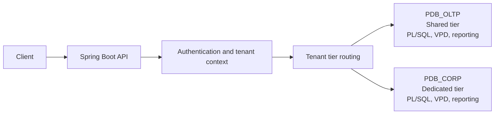

<div align="center">

# Multi-Tenant Order Management on Oracle Database

**An open-source proof of concept for tenant-aware order processing with Oracle Database, Spring Boot, and PL/SQL.**

[](https://openjdk.org/projects/jdk/21/)
[](https://spring.io/projects/spring-boot)
[](https://www.oracle.com/database/free/)
[](LICENSE)

</div>

This project explores database-enforced tenant isolation, PL/SQL business operations, idempotent APIs, inventory concurrency, and reporting with Oracle materialized views. It is intended for learning and experimentation in a local lab.

## Architecture



The backend uses a hexagonal structure: REST controllers call application use cases, which depend on repository ports. JDBC adapters use Oracle UCP and invoke PL/SQL packages. The application resolves the tenant and selects the PDB for its service tier; Oracle VPD applies tenant predicates to protected data in each PDB.

## Capabilities

- **Tenant isolation:** Oracle VPD/DBMS_RLS policies protect tenant-owned tables and reporting views. Requests are authenticated and bound to an authorized tenant.
- **Tier-based placement:** standard tenants use the shared `PDB_OLTP`; enterprise tenants use `PDB_CORP`.
- **Order processing:** create orders, add lines, confirm orders, cancel eligible orders, and register payments through REST endpoints and PL/SQL packages.
- **Inventory consistency:** `SELECT FOR UPDATE` serializes reservations so concurrent orders cannot oversell stock.
- **Idempotency:** create, confirm, cancel, and payment operations accept an `Idempotency-Key` and safely handle retries.
- **Transactional events:** PL/SQL writes audit and outbox records in the same transaction as order changes.
- **Reporting:** materialized views provide daily order and product sales summaries, with tenant-aware queries and a refresh endpoint.
- **Operations:** correlation IDs, structured logging, health endpoints, and Prometheus metrics support the local deployment.

## Technology

| Area | Components |
|---|---|
| Application | Java 21, Spring Boot 3.3, Spring MVC, Spring Security, Spring JDBC |
| Database | Oracle Database Free 23c, PL/SQL, VPD/DBMS_RLS, materialized views |
| Database access | Oracle UCP and JDBC driver |
| Schema management | Flyway |
| Local infrastructure | Podman, kind, Kubernetes |
| Build and QA | Maven, Ruby/Rake |

## Quick start

The local lab runs a dedicated `poc-oracle` kind cluster using Podman. It deploys the backend and Oracle, then initializes both PDBs with the same migrations, packages, and seed data.

Prerequisites: Podman with its machine running, kind, kubectl, Ruby/Rake, and Maven 3.9 or newer. From the repository root:

```sh
cp infrastructure/podman/.env.example infrastructure/podman/.env
# Edit infrastructure/podman/.env and set local lab credentials.
rake qa:up
rake qa:db:init
rake qa:wait
rake qa:smoke
```

`qa:up` creates the cluster, builds and loads the backend image, and deploys the workloads. `qa:db:init` applies migrations, deploys PL/SQL packages, and loads seed data into both PDBs. The first Oracle startup may take several minutes.

To remove the deployment and cluster:

```sh
rake qa:teardown
```

## Demo API

The API uses HTTP Basic authentication and the `X-Tenant-ID` header. The local profile defaults to `admin:changeme` and `operator:changeme`; set `APP_ADMIN_PASSWORD` and `APP_OPERATOR_PASSWORD` in your local `.env` to use different credentials.

| Operation | Endpoint |
|---|---|
| Create tenant | `POST /api/v1/tenants` |
| Create order | `POST /api/v1/orders` |
| Get order | `GET /api/v1/orders/{id}` |
| Add order line | `POST /api/v1/orders/{id}/lines` |
| Confirm order | `POST /api/v1/orders/{id}/confirm` |
| Cancel order | `POST /api/v1/orders/{id}/cancel` |
| Register payment | `POST /api/v1/orders/{id}/payments` |
| Refresh reports | `POST /api/v1/reports/refresh` |
| Query daily orders | `GET /api/v1/reports/orders/daily` |
| Query top products | `GET /api/v1/reports/products/top?limit=N` |
| Report freshness | `GET /api/v1/reports/freshness` |

Create, confirm, cancel, and payment requests support the `Idempotency-Key` header. Report responses include the `X-MV-Last-Refresh` header.

Seed data includes the `ACME`, `GLOBEX`, and `INITECH` tenants, products, warehouses, inventory, and a sample order. Non-admin users are restricted to the tenant codes configured for their account.

## Verification

Run the backend unit tests from `backend/`:

```sh
mvn test
```

Run database and API checks from the repository root after bringing up the lab:

```sh
rake qa:smoke        # HTTP health, authorization, order flow, and tenant checks
rake qa:db:verify    # VPD policies, tenant isolation, and order-to-payment flow
rake e2e:all         # Database scenarios and API routing between PDBs
rake qa:db:concurrency
```

The concurrency task accepts `QA_WORKERS` to set the number of competing workers. `rake -T qa` and `rake -T e2e` list the available tasks.

## Configuration

The local deployment reads credentials and ports from `infrastructure/podman/.env`. Keep this file local and use lab-only credentials. When changing Oracle schema passwords, keep them aligned with `infrastructure/podman/scripts/01-init-db.sql`.

| Setting | Purpose |
|---|---|
| `ORACLE_PASSWORD` | Oracle administrative password for initial database setup |
| `APP_OWNER_PWD` | Schema owner used for migrations and package deployment |
| `APP_RUNTIME_PWD` | Application database account |
| `APP_REPORTING_PWD` | Read-only reporting account |
| `APP_ADMIN_PASSWORD` | Local administrator account for the API |
| `APP_OPERATOR_PASSWORD` | Local operator account for the API |
| `APP_OPERATOR_TENANTS` | Tenant codes available to the operator account |
| `ORACLE_URL` | Shared PDB connection URL |
| `ORACLE_DEDICATED_URL` | Dedicated PDB connection URL |

Use `infrastructure/podman/.env.example` as the template. The lab defaults are for local demonstration only.

## Repository layout

```text
backend/           Spring Boot API and Maven build
database/          Flyway migrations, PL/SQL packages, security policies, and seed data
infrastructure/    Podman and Kubernetes deployment files
tests/             SQL integration, security, concurrency, performance, and resilience suites
Rakefile           Local lab and QA task automation
LICENSE            MIT License
```

## License

This project is licensed under the MIT License. See [LICENSE](LICENSE) for details.
