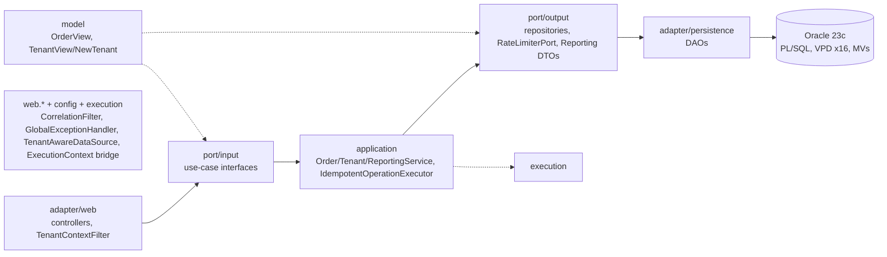

# 01 — Overview

Components (current code):

Enforcement: `architecture/HexagonalArchitectureTest` (ArchUnit, 15 rules).
Ports use model types; controllers map to DTOs (wire JSON unchanged).
Domain package deleted; `PaymentMethod` literal enum + consistency test only.
Reporting adds `ratelimiter/` and `GET /reports/freshness` + header.
